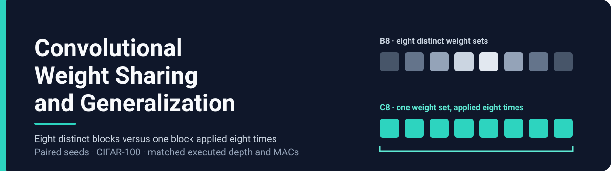
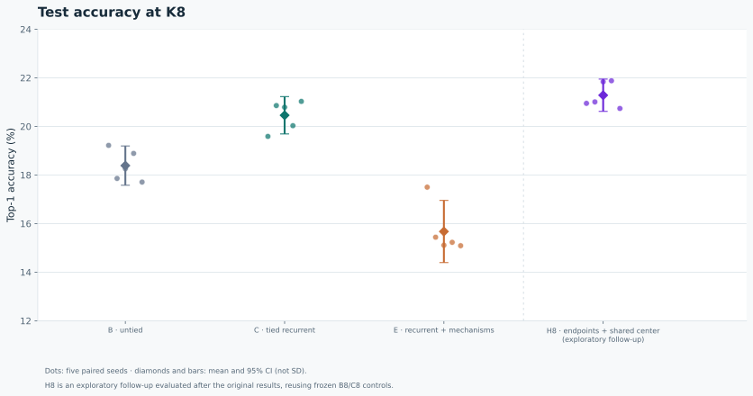
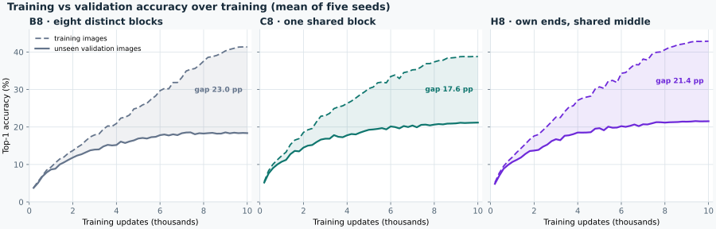
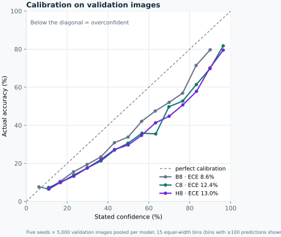
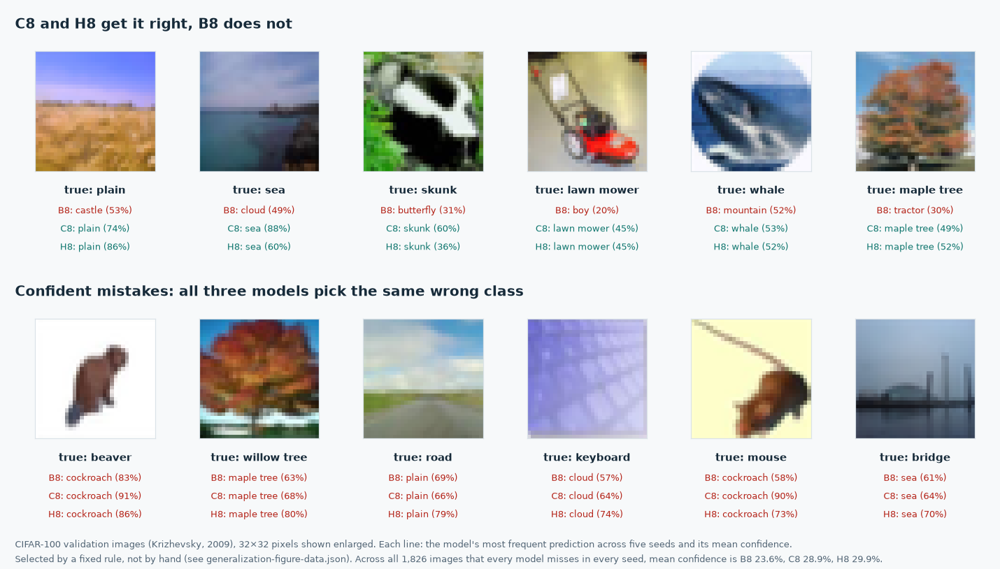
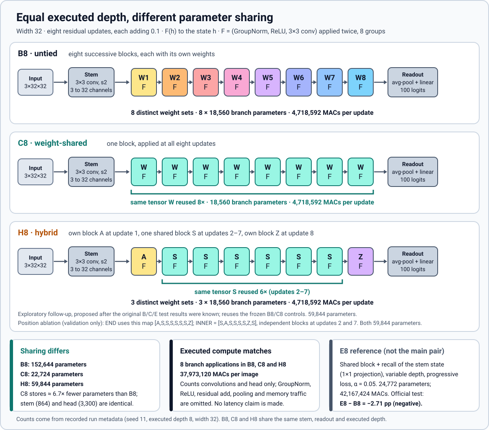
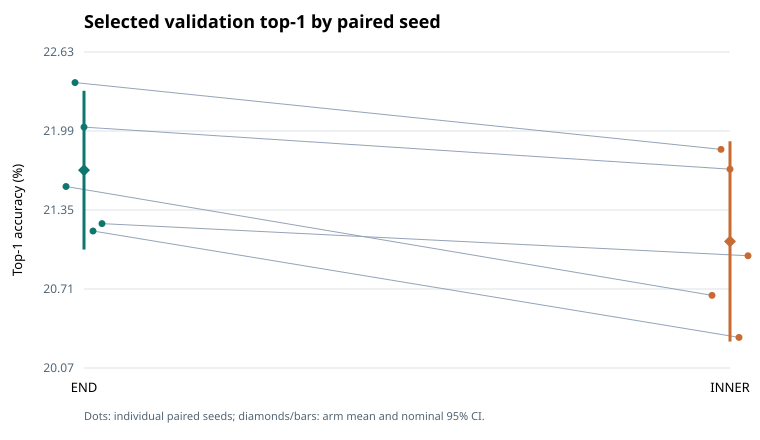
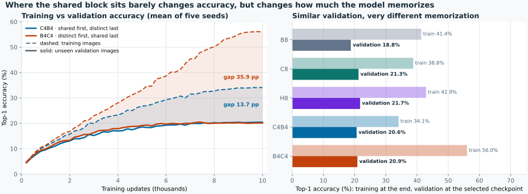
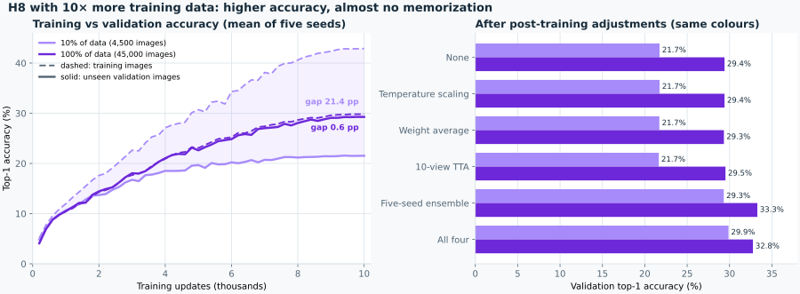

<p align="center">
  
</p>

# Convolutional Weight Sharing and Generalization


A controlled study of weight sharing in residual convolutional networks for image classification. At equal compute, reusing a single convolutional block across all eight residual updates (**C8**) generalizes better than eight independent blocks (**B8**) on CIFAR-100 with limited training data: **+2.07 pp test top-1 across five paired seeds, with 6.7× fewer parameters**. A hybrid that gives only the first and last updates their own weights (**H8**) achieves the highest accuracy, 21.28%.

B8, C8 and H8 share the same stem, classifier, eight-update residual trunk at width 32, training recipe and seeds; they differ only in how the trunk's weights are shared. A fourth model, E8, adds recurrence mechanisms on top of C8 and is reported as a reference.

**Follow-up with all the training data:** trained on 45,000 instead of 4,500 images, H8 rises from 21.7% to **29.4%** validation accuracy and nearly stops memorizing (train/validation gap 19.6 → 0.4 pp). See [H8 with 100% of the training data](#h8-with-100-of-the-training-data).

## Result at a glance

Official CIFAR-100 test set, top-1 accuracy, five paired seeds, eight iterations (K = 8), 4,500 training images per run.

| Model | Description | Parameters | MACs per image | Test top-1 (%) mean ± sd | 95% CI (t, df = 4) |
|---|---|---:|---:|---:|---|
| **B8** | eight distinct blocks | 152,644 | 37,973,120 | 18.39 ± 0.65 | [17.58, 19.20] |
| **C8** | one block, applied 8× | 22,724 | 37,973,120 | **20.46 ± 0.62** | [19.69, 21.23] |
| E8 | shared block + recall, variable depth, progressive loss | 24,772 | 42,167,424 | 15.67 ± 1.03 | [14.39, 16.95] |
| H8 † | independent first and last blocks around one shared block | 59,844 | 37,973,120 | 21.28 ± 0.54 | [20.62, 21.95] |

† Follow-up model, trained after the first three. It reuses the same B8 and C8 runs as its controls.

- **Primary contrast, C8 − B8: +2.07 percentage points** (95% CI [0.50, 3.64], paired t-test, df = 4, two-sided p = 0.021). All 5 of 5 seeds are positive: +0.37, +3.00, +2.53, +1.14, +3.32.
- **Secondary contrast, E8 − B8: −2.71 pp** (95% CI [−3.63, −1.80]); 0 of 5 seeds are positive. E8 is a negative addition, not part of the main pair.
- **Follow-up H8 is the most accurate model.** H8 − B8 is +2.90 pp (95% CI [2.04, 3.76], 5 of 5 seeds). H8 − C8 is +0.82 pp (95% CI [−0.27, 1.91], 4 of 5 seeds): ahead, but not yet clearly separated from C8.
- **Running 32 iterations at test time hurts.** With no retraining, accuracy falls by 13.24 pp for C (C32 − C8, CI [−15.20, −11.29]) and by 7.60 pp for E (E32 − E8, CI [−8.70, −6.50]). These models were trained at eight iterations and do not extrapolate to more.
- **Same counted MACs, fewer parameters.** B8, C8 and H8 execute 37,973,120 multiply-accumulates (MACs) under the repository's counting convention. C8 stores about 6.7× fewer parameters. No latency or wall-clock saving is claimed.

The table is a display copy computed from [`benchmarks/minimal-generalization-20261015/analysis/table.csv`](benchmarks/minimal-generalization-20261015/analysis/table.csv) and [`contrasts.csv`](benchmarks/minimal-generalization-20261015/analysis/contrasts.csv); the H8 row and contrasts come from [`benchmarks/hybrid-generalization-20261015/analysis/`](benchmarks/hybrid-generalization-20261015/analysis/). The generated result tables, [`docs/RESULTS.md`](docs/RESULTS.md) and [`assets/results-table.md`](assets/results-table.md), are produced by `scripts/make_figures.py` and take precedence over this page.

<p align="center">
  
</p>

Further figures, all generated from the same evidence:
[paired seed-level effects](assets/paired-effects.svg) ·
[parameter counts](assets/parameters.svg) ·
[accuracy at 8 versus 32 iterations](assets/iterations.svg).

## What the results say

**1. One shared block beats eight separate blocks.** C8 was ahead of B8 on every seed (+2.07 pp) while storing 6.7× fewer parameters and running the same compute. It was not simply that B8 memorized more: at its selected checkpoint C8 also fit the *training* set better (38.2% vs 35.5% clean train accuracy) and the validation set better (21.3% vs 18.8%). Our reading is that the shared block learns from all eight positions at once. Every training step sums eight gradients into the same weights. Those gradients point mostly the same way: coherence ρ ≈ 0.80 at the selected checkpoint, with 0 of 28 position pairs in conflict. Each step is therefore a stronger, cleaner signal. B8 splits the same signal across eight blocks, which is a poor trade when there are only 4,500 training images. Late in training, B8's train accuracy kept rising (41.4%) while its validation accuracy slipped.

**2. Giving the first and last steps their own weights helps further.** H8 (`[A,S,S,S,S,S,S,Z]`) was the best model on the test set (21.28%). A controlled follow-up shows *where* untying pays. With parameters, compute and initialization held fixed, free blocks at the ends (END) beat free blocks in the interior (INNER) on all five seeds (+0.58 pp validation, 95% CI [0.22, 0.93]). The first and last steps have different jobs from the middle: one adapts the stem's features, the other prepares features for the classifier. The middle steps do repeated refinement, which suits one shared block. With the ends freed, the six shared middle steps also kept more aligned gradients (ρ ≈ 0.88 for END vs 0.77 for INNER).

**3. Accuracy and calibration trade off.** B8 had the best-calibrated confidences (test ECE 8.8% vs 12.9% for C8 and 13.3% for H8), and INNER was better calibrated than END. The shared models are more accurate but more overconfident. Sharing alone does not make predicted probabilities more trustworthy.

**4. Running more steps at test time breaks the models, and the extra mechanisms did not help.** Going from 8 to 32 steps without retraining costs C 13.2 pp and E 7.6 pp. The block learned an eight-step trajectory, not a stable fixed point it can keep iterating. E8's recall, variable depth and progressive loss left it underfit in this budget (22.5% train accuracy) and 2.71 pp behind B8.

### Memorization versus generalization

The *train/validation gap* is clean training accuracy minus validation accuracy. Clean training accuracy is measured on the training images without augmentation. A large gap means much of what the model learned only works on the images it trained on, i.e. memorization. A small gap is only good when validation accuracy is also high. A small gap with low accuracy means the model did not learn the training set either.

| Model | Train, selected checkpoint | Validation | Gap | Train, end of training | Validation, end | Gap, end |
|---|--:|--:|--:|--:|--:|--:|
| B8 | 35.5% | 18.8% | 16.7 pp | 41.4% | 18.4% | **23.0 pp** |
| C8 | 38.2% | 21.3% | 17.0 pp | 38.8% | 21.2% | 17.6 pp |
| H8 | 41.4% | 21.7% | **19.6 pp** | 42.9% | 21.5% | 21.4 pp |
| E8 | 22.5% | 16.1% | 6.3 pp | 22.7% | 15.8% | 6.8 pp |

Means over five seeds, from the per-run training logs (`runs/*/metrics.jsonl.gz`). "Selected" is the checkpoint chosen on validation; "end" is update 10,000.

<p align="center">
  
</p>

- **B8 memorizes most by the end.** Training accuracy keeps rising (35.5% → 41.4%) while validation falls (18.8% → 18.4%). This is classic overfitting: its spare capacity goes into the training images.
- **H8 memorizes more *and* generalizes best.** It has the largest gap at the selected checkpoint, yet the highest accuracy on unseen images. Its extra endpoint parameters learn both useful features and image-specific detail.
- **C8 is the most contained of the models that learn well.** Its gap barely moves through training; one shared block has little spare capacity to memorize.
- **E8's small gap is underfitting, not good generalization.** It reaches only 22.5% on its own training images.

### Strengths and weaknesses by model

*ECE* (expected calibration error) measures whether stated confidence matches the observed hit rate. Predictions are grouped into 15 confidence bins. ECE is the count-weighted average gap between mean confidence and accuracy in each bin. Lower is better; 0% would mean that "70% confident" is right 70% of the time.

| Model | Strength | Weakness | Why |
|---|---|---|---|
| **B8** · eight independent blocks | Best calibrated (test ECE 8.8%). | Lowest accuracy of the three equal-compute models (18.39%) despite the most parameters (152,644), and the most late-training memorization. | Each block learns only from its own position's gradient, so the training signal is split eight ways. With 4,500 images it fits the training set worse than C8 at its best checkpoint, then spends spare capacity memorizing. |
| **C8** · one block × 8 | Best accuracy per parameter: 20.46% with 22,724 parameters. Stable gap. | Overconfident (test ECE 12.9%). Collapses when run for more steps (−13.2 pp at 32 steps). No step can specialize. | Every step trains the same weights with eight largely aligned gradients. It learns an eight-step trajectory, not a stable fixed point, so extra iterations push it off course. |
| **H8** · own first and last blocks, shared middle | Highest accuracy (21.28%), ahead of B8 on 5/5 seeds and C8 on 4/5. | Least calibrated (test ECE 13.3%). 2.6× C8's parameters, the largest selected gap, and the most seed-to-seed spread on validation (SD 1.25 vs 0.41 for C8). Lost to C8 on seed 71. | The first step adapts stem features and the last prepares features for the classifier, unlike the repeated refinement in the middle. The END vs INNER test shows untying pays at the ends rather than the interior. The extra parameters also add room to memorize. |
| **E8** · C8 + recall, variable depth, progressive loss | Smallest gap; degrades least at 32 steps (−7.6 pp vs −13.2 pp for C8). | Lowest accuracy (15.67%, 2.71 pp below B8). The only model with extra compute (42.2M MACs). | The added mechanisms hold it back in a 10,000-update budget: it underfits. Training at varied depths makes it more tolerant of extra steps. Several settings changed at once (including learning rate and α), so no single mechanism can be credited. |

<p align="center">
  
</p>

The calibration curve pools five seeds × 5,000 validation images per model, so its ECE values differ slightly from the per-seed test means quoted above.

### What this looks like on real images

Model predictions on CIFAR-100 validation images. The examples were picked by a fixed rule, requiring the pattern in at least four of five seeds, not by hand.

<p align="center">
  
</p>

- **Top row.** Examples of the shared models generalizing where B8 does not. On the validation set, C8 and H8 beat B8 consistently, in at least four seeds, on 10 images; the reverse happens on 3.
- **Bottom row.** The models share the same mistakes, mostly between similar-looking classes such as willow vs maple, road vs plain and mouse vs cockroach. On the 1,826 images that every model misses in every seed, mean confidence is 23.6% for B8, 28.9% for C8 and 29.9% for H8. The shared models are wrong just as often on these images, only more sure of themselves.

In every pair we measured, the more accurate model was also the more overconfident: C8/H8 vs B8 on test, and END vs INNER on validation. Pick H8 for accuracy, C8 when parameters are scarce, and B8 when predicted probabilities must be trustworthy.

**In short:** for small-data image classification at this scale, reusing one convolutional block is a better use of parameters than stacking distinct ones. The best layout we found keeps a shared middle and gives the first and last steps their own weights.

## Architecture

<p align="center">
  
</p>

B8, C8 and H8 all encode a 3×32×32 image with a stride-2 3×3 convolution into a 32-channel state at 16×16 resolution, apply eight residual updates `h ← h + α·F(h)` with α = 0.1, then average-pool and classify into 100 classes. The branch `F` is GroupNorm (8 groups) → ReLU → 3×3 convolution, applied twice, as implemented in [`src/recurrent_cnn/models.py`](src/recurrent_cnn/models.py).

| | B8 (untied) | C8 (weight-shared) | H8 (hybrid, exploratory) |
|---|---|---|---|
| Branch modules | 8, one per update | 1, reused at every update | 3: A (update 1), S (updates 2–7), Z (update 8) |
| Branch parameters | 8 × 18,560 | 1 × 18,560 | 3 × 18,560 |
| Stem + head parameters | 864 + 3,300 | 864 + 3,300 | 864 + 3,300 |
| Executed branch applications | 8 | 8 | 8 |
| MACs per image | 37,973,120 | 37,973,120 | 37,973,120 |

Parameter counts and MACs are read from the recorded run metadata (`runs/*/run.json`). The MAC convention counts convolutions and the linear head, and omits GroupNorm, ReLU, the residual add, pooling and memory traffic. Equal MACs therefore means equal counted compute, not equal speed.

E8 reuses one block as C8 does, and additionally concatenates the stem state back into each update through a 1×1 projection (recall), trains with variable depth and a progressive loss, and uses α = 0.05 and a different learning rate. That adds 2,048 parameters and 4,194,304 MACs relative to C8.

H8 (`[A,S,S,S,S,S,S,Z]`) keeps the recipe of B8 and C8 but unties only the first and last updates, giving three unique blocks and 59,844 parameters. The later validation-only [position ablation](#follow-up-studies) holds that three-block budget fixed and compares two maps: END uses the H8 map, and INNER (`[S,A,S,S,S,S,Z,S]`) moves the two independent blocks to updates 2 and 7.

## Experimental protocol

The protocol was fixed before the 15 training runs and is summarised in [`docs/MINIMAL_GENERALIZATION.md`](docs/MINIMAL_GENERALIZATION.md); the machine-readable version is [`protocol.json`](benchmarks/minimal-generalization-20261015/protocol.json).

| Item | Value |
|---|---|
| Dataset | CIFAR-100, 100 classes |
| Training data | 4,500 images per run (10% of the 45,000-image training partition) |
| Validation | 5,000 held-out training images, used only to select checkpoints |
| Test | 10,000 official test images, opened only after all 15 runs were complete and frozen |
| Seeds | 11, 23, 37, 53, 71, paired across B, C and E |
| Training | 10,000 updates, batch 128, SGD (momentum 0.9, weight decay 5e-4), cosine schedule, FP32 |
| Selection | validation top-1 at K = 8 every 200 updates; ties by lower cross-entropy, then earlier update |
| Statistics | paired seed as the unit; mean, sample sd, two-sided Student-t 95% CI with df = 4 |
| Hierarchy | fixed sequence: C8 − B8 first; E8 − B8 is inferential only if the primary lower bound exceeds zero |

K = 32 and validation-split intervals are descriptive diagnostics, not additional confirmatory tests.

## Follow-up studies

**H8.** `[A,S,S,S,S,S,S,Z]` keeps the B8/C8 recipe and unties only the endpoint blocks: three unique blocks, 59,844 parameters, same compute. It reuses the frozen B8/C8 runs as controls. Seed-level results, calibration and confidence bands are in the [H8 report](docs/HYBRID_GENERALIZATION.md); protocol and evidence are in [`benchmarks/hybrid-generalization-20261015/`](benchmarks/hybrid-generalization-20261015/README.md).

**END vs INNER position test (validation only).** Both arms have three unique blocks, 59,844 parameters, the same compute and the same C-initialized starting function. END frees updates 1 and 8 (`[A,S,S,S,S,S,S,Z]`); INNER frees updates 2 and 7 (`[S,A,S,S,S,S,Z,S]`). END reached 21.67% and INNER 21.10% selected-validation top-1, with END ahead on all five seeds; INNER had lower cross-entropy and ECE. These arms were never run on the test set, so they are not in the test chart above.

<p align="center">
  
</p>

Full analysis: [mechanism report](benchmarks/position-ablation-20261016/analysis/MECHANISM_ABLATION.md) · [study README and data](benchmarks/position-ablation-20261016/README.md) · [continuation provenance](benchmarks/position-ablation-20261016/provenance/README.md).

**C4B4 vs B4C4: sharing early or late (validation only).** Both models split the trunk in half: C4B4 applies one shared block at updates 1–4 and four distinct blocks at updates 5–8; B4C4 is the reverse. Both have five unique blocks (96,964 parameters) and the same compute as B8/C8/H8, use the same recipe, data subsets and seeds, and start from native independent initialization (blocks drawn exactly as B8's first five). B8, C8 and H8 are the existing runs.

<p align="center">
  
</p>

| Model | Unique blocks | Validation accuracy | Validation CE | Train accuracy, end | Gap, end |
|---|---:|---:|---:|---:|---:|
| B8 | 8 | 18.80% | 3.59 | 41.4% | 23.0 pp |
| C8 | 1 | 21.25% | 3.53 | 38.8% | 17.6 pp |
| H8 | 3 | **21.75%** | 3.54 | 42.9% | 21.4 pp |
| C4B4 | 5 | 20.64% | **3.41** | 34.1% | **13.7 pp** |
| B4C4 | 5 | 20.89% | 3.77 | **56.0%** | **35.9 pp** |

Means over five paired seeds; accuracy and cross-entropy (CE) at the checkpoint selected on validation. Paired contrasts, 95% CI (t, df = 4): C4B4 − B4C4 −0.25 pp [−0.99, 0.49]; vs B8 +1.84 and +2.09 pp (5/5 seeds each); vs C8 −0.61 and −0.36 pp (1/5 seeds each, intervals include zero); vs H8 −1.11 and −0.86 pp.

- **Where the shared half sits barely changes accuracy.** C4B4 and B4C4 are within 0.25 pp, with no consistent winner across seeds.
- **It strongly changes memorization.** With identical parameters and compute, B4C4 ends at 56% training accuracy, the highest of any model in the study, and a 35.9 pp gap. C4B4 ends at 34% with a 13.7 pp gap, the smallest among the models that learn well. B4C4's extra memorization buys no validation accuracy and gives the worst cross-entropy; C4B4 has the best cross-entropy of all five models despite lower accuracy than C8 and H8.
- **More distinct blocks is not better.** Both have 4.3× the parameters of C8 and neither beats it. H8, which unties only the first and last updates, stays best. Together with END/INNER, this points to *which* updates get their own weights mattering more than *how many* do.

Data and analysis: [`benchmarks/split-sharing-20261017/`](benchmarks/split-sharing-20261017/README.md).

## Post-training adjustments: C8 and H8

Can the two best models be improved after training, without retraining them? We applied four standard adjustments to the frozen five-seed C8 and H8 checkpoints and scored them on the 5,000 validation images. **Validation only:** the official test set was not reopened, and these models were originally selected on this same validation set, so the results are exploratory.

- **Temperature scaling:** one positive scalar rescales the logits, fitted by five-fold cross-fitting so no image is scored with a temperature fitted on itself. It changes confidence, never the predicted class.
- **Weight averaging:** the arithmetic midpoint of the selected checkpoint and the last checkpoint of the same run. This is not classical SWA or EMA, which would need intermediate snapshots.
- **Five-seed ensemble:** average the predicted probabilities of the five seeds.
- **Test-time augmentation (TTA):** average ten crop/flip views of each image.
- **All four:** average each run's two checkpoints, apply TTA, ensemble the five seeds, then calibrate.

| Adjustment | Passes per image | C8 accuracy | H8 accuracy | C8 ECE | H8 ECE |
|---|---:|---:|---:|---:|---:|
| None | 1 | 21.26% | 21.74% | 12.4% | 13.0% |
| Temperature scaling | 1 | 21.26% | 21.74% | **2.8%** | 3.5% |
| Weight average | 1 | 21.20% | 21.72% | 12.6% | 13.5% |
| Five-seed ensemble | 5 | 28.46% | 29.32% | 4.8% | 5.2% |
| TTA | 10 | 21.59% | 21.65% | 6.4% | 7.3% |
| **All four** | 50 | 29.16% | **29.88%** | 4.1% | 4.2% |

Single-model rows are means over five seeds; ensemble rows are one pooled predictor. Lower ECE is better.

**Train/validation gap after each adjustment.** Training accuracy is clean accuracy on each run's own 4,500 training images. An ensemble has no single shared training set, so its training accuracy is measured on the 18,446 images seen by at least one member, none of which are validation images.

| Adjustment | C8 train → val | C8 gap | H8 train → val | H8 gap |
|---|---:|---:|---:|---:|
| None / temperature scaling | 38.2% → 21.3% | 17.0 pp | 41.4% → 21.7% | 19.6 pp |
| Weight average | 38.5% → 21.2% | 17.3 pp | 42.4% → 21.7% | 20.7 pp |
| TTA | 37.8% → 21.6% | 16.2 pp | 40.9% → 21.7% | 19.3 pp |
| Five-seed ensemble † | 34.8% → 28.5% | 6.3 pp | 36.2% → 29.3% | 6.8 pp |
| All four † | 34.6% → 29.2% | 5.4 pp | 36.0% → 29.9% | 6.1 pp |

† Union of the five training subsets. The drop from about 17–20 pp to about 6 pp partly reflects this different training set, so it is not by itself proof of less memorization.

What this shows:

- **The ranking does not change.** H8 is more accurate in every configuration; C8 has lower ECE and a smaller gap in every configuration, with 2.6× fewer parameters.
- **Ensembling gives almost all of the accuracy gain** (+7.2 pp for C8, +7.6 pp for H8) for 5 passes. Adding the other three adjustments buys +0.6 to +0.7 pp more for 10× the passes.
- **Temperature scaling is the cheap calibration fix:** ECE falls from about 13% to about 3% at no inference cost, with accuracy unchanged.
- **The checkpoint midpoint does not help:** it fits training slightly better and validation slightly worse. TTA narrows the gap for both models but improves accuracy only for C8.

Details, NLL/Brier scores and reproduction commands: [C8 vs H8 post-training report](docs/C8_POSTTRAINING.md) · [H8 post-training report](docs/H8_POSTTRAINING.md) · data in [`benchmarks/c8-posttraining-validation/`](benchmarks/c8-posttraining-validation/), [`benchmarks/h8-posttraining-validation/`](benchmarks/h8-posttraining-validation/) and [`benchmarks/posttraining-generalization-validation/`](benchmarks/posttraining-generalization-validation/).

## H8 with 100% of the training data

Every result above uses 10% of the CIFAR-100 training data (4,500 images per run). Was that the limit? We retrained H8 with the **same recipe, seeds and 10,000 updates on all 45,000 training images**, then repeated the post-training adjustments. **Validation only:** the official test set was not reopened.

<p align="center">
  
</p>

| Adjustment | Accuracy, 10% → 100% data | ECE, 10% → 100% | Train/validation gap, 10% → 100% |
|---|---:|---:|---:|
| None | 21.74% → **29.41%** | 13.0% → 2.4% | 19.6 → **0.4** pp |
| Temperature scaling | 21.74% → 29.41% | 3.5% → 2.5% | 19.6 → 0.4 pp |
| Weight average | 21.72% → 29.34% | 13.5% → 2.3% | 20.7 → 0.5 pp |
| TTA | 21.65% → 29.52% | 7.3% → 5.7% | 19.3 → 0.6 pp |
| Five-seed ensemble | 29.32% → **33.28%** | 5.2% → 8.5% | 6.8 † → 0.4 pp |
| All four | 29.88% → 32.76% | 4.2% → **2.0%** | 6.1 † → 0.7 pp |

† At 10%, measured on the union of the five training subsets (see above). At 100%, all members trained on the same 45,000 images.

What this shows:

- **Data was the main bottleneck.** One H8 trained on all the data (29.41%) matches the ensemble of five 10%-data H8 models (29.32%) at one fifth of the inference cost.
- **Memorization is gone; the model is now underfit.** Training and validation accuracy are almost equal (about 30%), and every seed selected a checkpoint at the end of training (updates 9,200–10,000). With 10% of the data, the same model reached 43% on its training images; on 45,000 images it reaches only 30%. Capacity (59,844 parameters, width 32) and training length (≈ 28 passes over the data) are now the limits. Neither was tested here.
- **Calibration no longer needs fixing.** The plain model already has 2.4% ECE, so temperature scaling has nothing left to correct.
- **Only the ensemble still adds accuracy:** +3.9 pp, but averaging the five probability outputs raises ECE to 8.5%. Combining all four adjustments recovers the best calibration (2.0%) at 0.5 pp less accuracy and 10× the passes. Weight averaging and TTA change accuracy by less than 0.2 pp.

Details and reproduction: [H8 full-data report](docs/H8_FULL_DATA.md) · data in [`benchmarks/h8-full-data-20261017/`](benchmarks/h8-full-data-20261017/results/).

## Caveats

- **Scale.** One dataset (CIFAR-100 with 10% of the training data), width 32 and five seeds per model; absolute accuracy is around 20%. Only H8 was retrained on 100% of the data, on validation; B8 and C8 were not. Wider models, longer training and other tasks were not tested.
- **Order of the studies.** C8 − B8 was chosen as the main comparison after a one-seed pilot. H8, END/INNER, C4B4/B4C4 and the post-training adjustments were designed after the first results; END/INNER, C4B4/B4C4 and post-training were scored on validation only. C inherited B's learning rate instead of being tuned on its own.
- **Explanations.** The readings above combine the measured results with gradient and training-curve diagnostics; they are not separate interventions that isolate each cause. Run C-s53 was resumed from a checkpoint ([`docs/PROVENANCE.md`](docs/PROVENANCE.md)).

## Running the code

Python 3.12 or newer is required; the dependencies are in [`pyproject.toml`](pyproject.toml).

```bash
python -m pip install -e '.[test]'

# A synthetic, two-update CPU smoke check of the training path.
# It exercises the code only and is not a scientific result.
python scripts/smoke.py

# Recompute the paired analysis from the committed evidence.
# NEW_ANALYSIS_DIR must not exist yet.
python benchmarks/minimal-generalization-20261015/analyze_study.py \
  --input benchmarks/minimal-generalization-20261015 \
  --output NEW_ANALYSIS_DIR

# Regenerate the four figures and the result tables.
python scripts/make_figures.py --output-dir assets

# Generalization figures. The learning curves use the committed logs; the
# calibration and example figures need validation predictions from the
# private checkpoints (official test set never opened).
python scripts/infer_validation_examples.py --checkpoints CKPT_DIR --data-root LOCAL_CIFAR100_ROOT --output PRED_DIR
python scripts/make_generalization_figures.py --predictions PRED_DIR --meta LOCAL_CIFAR100_ROOT/cifar-100-python/meta

# Prepare an inert, freshly owned root for a GPU replication.
python scripts/prepare_replication.py --root NEW_ROOT --training-root LOCAL_CIFAR100_ROOT
```

Full replication is not a one-line command. The preserved training operator was written for a controlled single-GPU environment (NVIDIA RTX 5090) and a dedicated, freshly owned working root, and it forbids network access during the run. Read [`docs/REPRODUCIBILITY.md`](docs/REPRODUCIBILITY.md) first. A complete replication has not been re-run for this public export; the committed evidence and checkpoint hashes are those of the original run.

## Repository layout

```text
.
├── README.md
├── LICENSE
├── pyproject.toml
├── assets/                     banner, architecture diagram, figures, generated results table
├── benchmarks/
│   ├── minimal-generalization-20261015/   protocol, freeze, per-run metadata and metrics, analysis
│   ├── hybrid-generalization-20261015/    exploratory H8 follow-up: protocol, evidence, analysis
│   ├── position-ablation-20261016/        validation-only END/INNER position ablation and provenance
│   ├── c8-posttraining-validation/        C8 post-training results and C8 vs H8 comparison
│   ├── h8-posttraining-validation/        H8 post-training results
│   ├── posttraining-generalization-validation/  train/validation gaps after post-training
│   ├── h8-full-data-20261017/             H8 retrained on 100% of the training data, with post-training
│   ├── split-sharing-20261017/            validation-only C4B4 vs B4C4 (shared half first or last)
│   └── duration-calibration-20261015/     duration calibration script
├── configs/                    training and profiling presets
├── docs/
│   ├── C8_POSTTRAINING.md                 C8 vs H8 post-training and gap report
│   ├── H8_FULL_DATA.md                    H8 on 100% of the training data
│   ├── H8_POSTTRAINING.md                 H8 post-training report
│   ├── HYBRID_GENERALIZATION.md           generated H8 report
│   ├── MINIMAL_GENERALIZATION.md          fixed protocol and what was completed
│   ├── PROVENANCE.md                      source hashes and packaging notes
│   ├── REPRODUCIBILITY.md                 replication requirements
│   └── RESULTS.md                         generated results summary
├── provenance/                 frozen source archive and manifest
├── scripts/                    smoke check, figure generation, replication preparation
├── src/recurrent_cnn/          models, data, training engine, analysis
└── tests/
```

## Data, checkpoints and license

- **Data.** CIFAR-100 is not redistributed here. Obtain it from the [official page](https://www.cs.toronto.edu/~kriz/cifar.html) and follow its terms. The dataset is described in Krizhevsky (2009).
- **Checkpoints.** Model checkpoints are not included and no public release of them is promised. Their SHA-256 hashes are recorded in `analysis/table.csv` and `freeze.json`.
- **License.** The original code and documentation in this repository are released under the [Apache License 2.0](LICENSE). See [third-party notices and distribution boundaries](THIRD_PARTY_NOTICES.md) for dependency licenses, dataset rights and checkpoint exclusions.

## Related work and references

- A. Krizhevsky, *Learning Multiple Layers of Features from Tiny Images*, technical report, University of Toronto, 2009 ([dataset page](https://www.cs.toronto.edu/~kriz/cifar.html)).
- A. Schwarzschild et al., [*Can You Learn an Algorithm? Generalizing from Easy to Hard Problems with Recurrent Networks*](https://arxiv.org/abs/2106.04537). Recurrent, weight-shared networks are trained on easy problems and evaluated with more iterations on harder ones. This repository instead fixes the iteration count at training time and tests a shared block against untied blocks on image classification.
- A. Schwarzschild et al., [*The Uncanny Similarity of Recurrence and Depth*](https://arxiv.org/abs/2102.11011). Related comparison of recurrent and deeper feed-forward networks.

## Citation

No paper, DOI or formal release accompanies this repository. If you use it, cite the repository URL, <https://github.com/Hmenez3s/cnn-weight-sharing-generalization>, together with the exact commit hash you used. No author list is asserted here.
