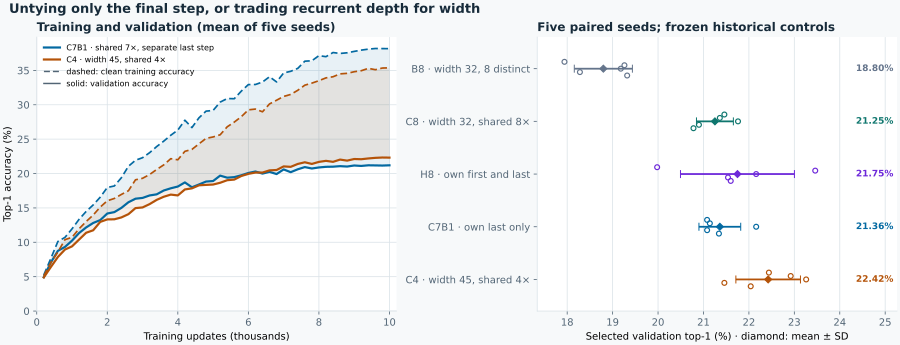

<p align="center">
  
</p>

# Convolutional Weight Sharing and Generalization


A controlled study of weight sharing in residual convolutional networks for image classification. At equal compute, reusing a single convolutional block across all eight residual updates (**C8**) generalizes better than eight independent blocks (**B8**) on CIFAR-100 with limited training data: **+2.07 pp test top-1 across five paired seeds, with 6.7× fewer parameters**. A hybrid that gives only the first and last updates their own weights (**H8**) achieves the highest mean among the original test-evaluated models, 21.28%.

B8, C8 and H8 share the same stem, classifier, eight-update residual trunk at width 32, training recipe and seeds; they differ only in how the trunk's weights are shared. A fourth model, E8, adds recurrence mechanisms on top of C8 and is reported as a reference.

**Architecture follow-ups (validation only):** freeing early weights can increase overfitting without a clear accuracy gain. A four-step, width-45 shared model (**C4W45**) reaches **22.42% validation accuracy** and is faster in the resident-input RTX 5090 benchmark. These exploratory results are [interpreted together below](#what-the-results-say), not mixed into the original test ranking.

**Follow-up with all the training data:** trained on 45,000 instead of 4,500 images, H8 rises from 21.7% to **29.4%** validation accuracy and nearly stops memorizing (train/validation gap 19.6 → 0.4 pp). See [H8 with 100% of the training data](#h8-with-100-of-the-training-data).

## Result at a glance

Official CIFAR-100 test set, top-1 accuracy, five paired seeds, eight iterations (K = 8), 4,500 training images per run.

| Model | Description | Parameters | MACs per image | Test top-1 (%) mean ± sd | 95% CI (t, df = 4) |
|---|---|---:|---:|---:|---|
| **B8** | eight distinct blocks | 152,644 | 37,973,120 | 18.39 ± 0.65 | [17.58, 19.20] |
| **C8** | one block, applied 8× | 22,724 | 37,973,120 | **20.46 ± 0.62** | [19.69, 21.23] |
| E8 | shared block + recall, variable depth, progressive loss | 24,772 | 42,167,424 | 15.67 ± 1.03 | [14.39, 16.95] |
| H8 † | independent first and last blocks around one shared block | 59,844 | 37,973,120 | 21.28 ± 0.54 | [20.62, 21.95] |

† Follow-up model, trained after the first three. It reuses the same B8 and C8 runs as its controls.

- **Primary contrast, C8 − B8: +2.07 percentage points** (95% CI [0.50, 3.64], paired t-test, df = 4, two-sided p = 0.021). All 5 of 5 seeds are positive: +0.37, +3.00, +2.53, +1.14, +3.32.
- **Secondary contrast, E8 − B8: −2.71 pp** (95% CI [−3.63, −1.80]); 0 of 5 seeds are positive. E8 is a negative addition, not part of the main pair.
- **Follow-up H8 is the most accurate model.** H8 − B8 is +2.90 pp (95% CI [2.04, 3.76], 5 of 5 seeds). H8 − C8 is +0.82 pp (95% CI [−0.27, 1.91], 4 of 5 seeds): ahead, but not yet clearly separated from C8.
- **Running 32 iterations at test time hurts.** With no retraining, accuracy falls by 13.24 pp for C (C32 − C8, CI [−15.20, −11.29]) and by 7.60 pp for E (E32 − E8, CI [−8.70, −6.50]). These models were trained at eight iterations and do not extrapolate to more.
- **Same counted MACs, fewer parameters.** B8, C8 and H8 execute 37,973,120 multiply-accumulates (MACs) under the repository's counting convention. C8 stores about 6.7× fewer parameters. A separate [RTX 5090 speed benchmark](benchmarks/rtx5090-speed-20261017/README.md) finds similar speeds for these eight-update models; fewer stored weights do not establish a latency saving.

The table is a display copy computed from [`benchmarks/minimal-generalization-20261015/analysis/table.csv`](benchmarks/minimal-generalization-20261015/analysis/table.csv) and [`contrasts.csv`](benchmarks/minimal-generalization-20261015/analysis/contrasts.csv); the H8 row and contrasts come from [`benchmarks/hybrid-generalization-20261015/analysis/`](benchmarks/hybrid-generalization-20261015/analysis/). The generated result tables, [`docs/RESULTS.md`](docs/RESULTS.md) and [`assets/results-table.md`](assets/results-table.md), are produced by `scripts/make_figures.py` and take precedence over this page.

<p align="center">
  
</p>

Further figures, all generated from the same evidence:
[paired seed-level effects](assets/paired-effects.svg) ·
[parameter counts](assets/parameters.svg) ·
[accuracy at 8 versus 32 iterations](assets/iterations.svg).

## What the results say

The original B8/C8/E8 comparison and H8 follow-up have official-test results. Subsequent architecture ablations use validation only: five paired seeds, exploratory nominal 95% intervals, without multiplicity correction. A higher mean is not an established win when its paired interval includes zero.

**1. Sharing can improve learning, not just restrict memorization.** C8 beat B8 on every test seed (+2.07 pp), with 6.7× fewer parameters and equal counted compute. At the selected checkpoint it also fit the *training* set better (38.2% vs 35.5%) and validation better (21.3% vs 18.8%). One possible explanation is how the learning signal is combined: all eight positions update the same weights, and their gradients are mostly aligned (coherence ρ ≈ 0.80, no conflicting pairs among 28). B8 distributes that signal across eight separate blocks. This is a mechanism supported by diagnostics, not an isolated causal proof; parameter count alone does not explain the fitting order.

**2. Where weights are independent matters, but extra fitting need not buy accuracy.** At fixed parameters, compute and starting function, END beat INNER on all five validation seeds (+0.58 pp [0.22, 0.93]); its shared-middle gradients were more aligned (ρ ≈ 0.88 vs 0.77). Yet freeing early weights also shows a repeated overfitting pattern. B4C4 ends with a **22.27 pp larger gap** than C4B4 at the same parameter budget. H8 has a **4.39 pp larger final gap [3.81, 4.98]** than C7B1, with higher training accuracy in every seed. Neither comparison establishes a selected top-1 advantage for the more overfit model. Early specialization and added capacity are plausible explanations; H8 versus C7B1 does not separate those two causes.

**3. Compute allocation matters more than simply choosing four or eight steps.** C4W45 (one shared block, four updates, width 45) reaches **22.42% validation accuracy**, ahead of C8 by +1.17 pp [0.66, 1.68] at slightly fewer counted MACs. At four steps, C4W45 also beats narrow C4W32 by **+2.05 pp [0.64, 3.47]**, in all five seeds; reducing depth alone therefore does not explain the result. The shallow/wide change helps the untied family too: B4W45 − B8 is **+2.62 pp [1.36, 3.89]**. Width 45 also changes GroupNorm from eight groups to one, so these gains belong to the native width/depth/normalization configurations, not to width alone. C4W45 has the highest mean in these small-data validation comparisons, but is not clearly separated from H8 or B4W45.

**4. Equal MACs do not imply equal speed, and fewer weights do not guarantee it.** The eight-update models have closely clustered RTX 5090 step times despite different parameter counts. C4W45, with only 0.88% fewer MACs than C8, is **1.82× faster at batch-1 inference**, has **1.37× the batch-128 inference throughput** and **1.44× the SGD throughput**. These are isolated, resident-input measurements, not concurrent training durations or deployment throughput. Width, recurrence count and normalization change together; no single operation is identified as the cause.

**5. Accuracy, probability quality and calibration are different outcomes.** Among B8/C8/H8, B8 has the lowest test ECE (8.8% vs 12.9% and 13.3%), despite lower accuracy; INNER is also better calibrated than END. H8 versus C7B1 adds another distinction: its mean top-1 is slightly higher but inconclusive, while its final validation cross-entropy is worse. Accuracy counts correct classes; cross-entropy also scores the probability assigned to the true class. Neither metric is interchangeable with ECE, and calibration was not measured for every new architecture.

**6. More inference steps and added recurrence mechanisms are not automatic improvements.** Going from 8 to 32 steps without retraining costs C 13.2 pp and E 7.6 pp. The trained eight-step trajectory does not extrapolate to more iterations. E8's recall, variable depth and progressive loss left it underfit in this budget (22.5% train accuracy) and 2.71 pp behind B8; multiple settings changed, so the individual mechanisms are not isolated.

### Memorization versus generalization

The *train/validation gap* is clean training accuracy minus validation accuracy; training images are evaluated without augmentation. A larger gap is consistent with overfitting, not a direct count of memorized examples. A small gap is useful only alongside good validation accuracy: it can also result from underfitting.

| Model | Train, selected checkpoint | Validation, selected | Gap, selected | Gap, end |
|---|--:|--:|--:|--:|
| B8 | 35.53% | 18.80% | 16.74 pp | 22.99 pp |
| C8 | 38.22% | 21.25% | 16.97 pp | 17.61 pp |
| H8 | 41.39% | 21.75% | 19.64 pp | 21.36 pp |
| E8 · reference | 22.5% | 16.1% | 6.3 pp | 6.8 pp |
| C4B4 · shared first half | 32.80% | 20.64% | 12.16 pp | 13.66 pp |
| B4C4 · shared last half | 45.97% | 20.89% | 25.09 pp | **35.93 pp** |
| C7B1 · shared seven, own last | 37.73% | 21.36% | 16.37 pp | 16.96 pp |
| C4W32 · narrow, shared four | 31.27% | 20.37% | 10.89 pp | 11.90 pp |
| C4W45 · wide, shared four | 35.33% | **22.42%** | 12.91 pp | 13.06 pp |
| B4W45 · wide, distinct four | 34.58% | 21.42% | 13.16 pp | 13.64 pp |

Rounded means over five seeds with 4,500 training images and 10,000 updates; E8 is the reference with a different recipe. Each model selects its own validation checkpoint; final gaps are all at update 10,000. These are **validation, not official-test scores**. B8/C8/H8 and C4W45 are reused controls, not new replications in each table. Sources: [original study](docs/MINIMAL_GENERALIZATION.md), [split-sharing](benchmarks/split-sharing-20261017/results/analysis.md), [endpoints/width](benchmarks/endpoint-width-20261017/results/analysis.md) and [native width/depth controls](benchmarks/width-depth-20261017/results/analysis.md).

<p align="center">
  
</p>

- **Position can change fitting far more than accuracy.** B4C4 reaches 56.04% final training accuracy versus C4B4's 34.08%, with the same parameters and compute, yet their selected validation means differ by only 0.25 pp and the interval includes zero. This is not a parameter-count effect.
- **H8's extra first block has a similar, smaller pattern.** Relative to C7B1, selected training accuracy and gap are higher in all five seeds (+3.66 and +3.27 pp). At the same final update, H8 also has worse validation CE: +0.112 [0.035, 0.189]. This evidence of overfitting does not establish C7B1 as more accurate; H8 − C7B1 top-1 is +0.39 pp [−1.15, +1.92].
- **More parameters do not necessarily fit more at this budget.** C8 fits training better than B8 at selection, and B4W45 finishes at 34.87% training accuracy versus C4W45's 35.37%, despite having 152,335 versus 42,445 parameters. Sharing affects how weights learn, not only how many there are.
- **A smaller gap is not a sufficient model-selection rule.** C4W32 has a smaller gap than C4W45 but lower validation accuracy; E8's small gap accompanies only 22.5% training accuracy. C4W45 combines the highest validation mean here with less training fit than H8 or B4C4, but its accuracy advantage over H8 is inconclusive.
- **Less overfitting does not establish earlier learning.** C7B1's selected checkpoint averages 9,200 updates versus H8's 8,440; both first reach 19% validation accuracy at a mean 4,520 updates. These sampled observations do not show that C7B1 needs less training or runs faster. [Matched-update and paired dynamics](benchmarks/width-depth-20261017/results/endpoint-dynamics.md) separate fitting, CE, gap and timing.

### Strengths and weaknesses by model

*ECE* (expected calibration error) measures whether stated confidence matches the observed hit rate. Predictions are grouped into 15 confidence bins. ECE is the count-weighted average gap between mean confidence and accuracy in each bin. Lower is better; 0% would mean that "70% confident" is right 70% of the time.

Test scores and ECE below refer only to the original test-evaluated models; all new architecture scores are validation only. The final column gives interpretations, not a general causal law about parameter count.

| Model | Strength | Weakness | Reading |
|---|---|---|---|
| **B8** · eight independent blocks | Lowest test ECE among B8/C8/H8 (8.8%). | Lowest test accuracy of that trio (18.39%); large late-training gap despite 152,644 parameters. | Independent weights split the position-wise learning signal; additional fitting late in training does not improve validation. |
| **C8** · one block × 8 | 20.46% test accuracy with only 22,724 parameters; relatively stable gap. | Test ECE 12.9%; loses 13.2 pp when run at 32 steps. | Reuse combines mostly aligned gradients, but the learned trajectory does not extrapolate to more steps. |
| **H8** · own ends, shared middle | Highest original test mean (21.28%); END/INNER supports the endpoint layout. | No clear test separation from C8; larger gap than C8/C7B1 and test ECE 13.3%. | Endpoint specialization can help, while the extra first block also increases fitting without a clear validation gain over C7B1. |
| **E8** · extra recurrence mechanisms | Smaller 32-step drop than C8 (−7.6 pp); small gap. | Underfits; 15.67% test accuracy at higher counted compute (42.2M MACs). | Several mechanisms and recipe settings changed together; their individual effects are not isolated. |
| **C4B4 / B4C4** · shared first / last half | Same parameter/compute budget reveals a strong positional effect on fitting. | No established validation gain over C8; B4C4 has a much larger gap and worse CE than C4B4. | Moving the shared half changes overfitting much more than selected accuracy. |
| **C7B1** · shared seven, own last | 21.36% validation with 41,284 parameters; lower gap and CE than H8. | No established accuracy gain over C8 or H8; not selected earlier on average. | Removing the independent first step changes capacity and specialization together, not accuracy alone. |
| **C4W32** · narrow, shared four | 22,724 parameters and 19.10M MACs; small gap. | 20.37% validation; below wide C4 in every seed. No clear difference from C8. | Fewer recurrent steps alone do not recover the wide model's result. |
| **C4W45** · wide, shared four | Highest mean in these small-data architecture validation comparisons (22.42%); measured speed gain over C8. | Not clearly separated from H8 or B4W45; widening also changes GroupNorm. No official-test or ECE result. | A promising compute allocation, not an isolated width effect or a new confirmed test winner. |
| **B4W45** · wide, distinct four | 21.42% validation; +2.62 pp over B8, positive in every seed. | More parameters than C4W45 without greater mean training fit or an established accuracy gain. No separate speed or ECE measurement. | The shallow/wide configuration also helps without sharing; architecture shape matters alongside weight reuse. |

<p align="center">
  
</p>

The calibration curve pools five seeds × 5,000 validation images per model, so its ECE values differ slightly from the per-seed test means quoted above.

### What this looks like on real images

Model predictions on CIFAR-100 validation images. The examples were picked by a fixed rule, requiring the pattern in at least four of five seeds, not by hand.

<p align="center">
  
</p>

- **Top row.** Examples of the shared models generalizing where B8 does not. On the validation set, C8 and H8 beat B8 consistently, in at least four seeds, on 10 images; the reverse happens on 3.
- **Bottom row.** The models share the same mistakes, mostly between similar-looking classes such as willow vs maple, road vs plain and mouse vs cockroach. On the 1,826 images that every model misses in every seed, mean confidence is 23.6% for B8, 28.9% for C8 and 29.9% for H8. The shared models are wrong just as often on these images, only more sure of themselves.

The accuracy/calibration trade-off was measured for C8/H8 versus B8 on test and END versus INNER on validation; it is not established for every newer architecture. Among the original B8/C8/H8, H8 leads test accuracy, C8 uses the fewest parameters and B8 has the lowest ECE. Lower CE in a follow-up does not by itself establish better calibration.

**In short:** how and where weights are reused matters more than parameter count alone. Sharing can improve training and validation together; extra independent early weights can mostly add overfitting; spending the compute budget on a shallow/wide configuration can improve validation and measured speed. H8 leads the original test comparison; C4W45 is a promising validation-only alternative, not a confirmed replacement. The width/normalization and early-capacity explanations remain partly unresolved.

## Architecture

<p align="center">
  
</p>

B8, C8 and H8 all encode a 3×32×32 image with a stride-2 3×3 convolution into a 32-channel state at 16×16 resolution, apply eight residual updates `h ← h + α·F(h)` with α = 0.1, then average-pool and classify into 100 classes. The branch `F` is GroupNorm (8 groups) → ReLU → 3×3 convolution, applied twice, as implemented in [`src/recurrent_cnn/models.py`](src/recurrent_cnn/models.py).

| | B8 (untied) | C8 (weight-shared) | H8 (hybrid, exploratory) |
|---|---|---|---|
| Branch modules | 8, one per update | 1, reused at every update | 3: A (update 1), S (updates 2–7), Z (update 8) |
| Branch parameters | 8 × 18,560 | 1 × 18,560 | 3 × 18,560 |
| Stem + head parameters | 864 + 3,300 | 864 + 3,300 | 864 + 3,300 |
| Executed branch applications | 8 | 8 | 8 |
| MACs per image | 37,973,120 | 37,973,120 | 37,973,120 |

Parameter counts and MACs are read from the recorded run metadata (`runs/*/run.json`). The MAC convention counts convolutions and the linear head, and omits GroupNorm, ReLU, the residual add, pooling and memory traffic. Equal MACs therefore means equal counted compute, not equal speed.

E8 reuses one block as C8 does, and additionally concatenates the stem state back into each update through a 1×1 projection (recall), trains with variable depth and a progressive loss, and uses α = 0.05 and a different learning rate. That adds 2,048 parameters and 4,194,304 MACs relative to C8.

H8 (`[A,S,S,S,S,S,S,Z]`) keeps the recipe of B8 and C8 but unties only the first and last updates, giving three unique blocks and 59,844 parameters. The later validation-only [position ablation](#follow-up-studies) holds that three-block budget fixed and compares two maps: END uses the H8 map, and INNER (`[S,A,S,S,S,S,Z,S]`) moves the two independent blocks to updates 2 and 7.

## Experimental protocol

The protocol was fixed before the 15 training runs and is summarised in [`docs/MINIMAL_GENERALIZATION.md`](docs/MINIMAL_GENERALIZATION.md); the machine-readable version is [`protocol.json`](benchmarks/minimal-generalization-20261015/protocol.json).

| Item | Value |
|---|---|
| Dataset | CIFAR-100, 100 classes |
| Training data | 4,500 images per run (10% of the 45,000-image training partition) |
| Validation | 5,000 held-out training images, used only to select checkpoints |
| Test | 10,000 official test images, opened only after all 15 runs were complete and frozen |
| Seeds | 11, 23, 37, 53, 71, paired across B, C and E |
| Training | 10,000 updates, batch 128, SGD (momentum 0.9, weight decay 5e-4), cosine schedule, FP32 |
| Selection | validation top-1 at K = 8 every 200 updates; ties by lower cross-entropy, then earlier update |
| Statistics | paired seed as the unit; mean, sample sd, two-sided Student-t 95% CI with df = 4 |
| Hierarchy | fixed sequence: C8 − B8 first; E8 − B8 is inferential only if the primary lower bound exceeds zero |

K = 32 and validation-split intervals are descriptive diagnostics, not additional confirmatory tests.

## Follow-up studies

These are the designs behind the consolidated findings above. Except for the original H8 follow-up, they use validation only and do not change the official-test table. Archived controls are reused, not retrained for each comparison.

**H8.** `[A,S,S,S,S,S,S,Z]` keeps the B8/C8 recipe and unties only the endpoint blocks: three unique blocks, 59,844 parameters, same compute. It reuses the frozen B8/C8 runs as controls. Seed-level results, calibration and confidence bands are in the [H8 report](docs/HYBRID_GENERALIZATION.md); protocol and evidence are in [`benchmarks/hybrid-generalization-20261015/`](benchmarks/hybrid-generalization-20261015/README.md).

**END vs INNER position test (validation only).** Both arms have three unique blocks, 59,844 parameters, the same compute and the same C-initialized starting function. END frees updates 1 and 8 (`[A,S,S,S,S,S,S,Z]`); INNER frees updates 2 and 7 (`[S,A,S,S,S,S,Z,S]`). END reached 21.67% and INNER 21.10% selected-validation top-1, with END ahead on all five seeds; INNER had lower cross-entropy and ECE. These arms were never run on the test set, so they are not in the test chart above.

<p align="center">
  
</p>

Full analysis: [mechanism report](benchmarks/position-ablation-20261016/analysis/MECHANISM_ABLATION.md) · [study README and data](benchmarks/position-ablation-20261016/README.md) · [continuation provenance](benchmarks/position-ablation-20261016/provenance/README.md).

**C4B4 vs B4C4: sharing early or late (validation only).** Both models split the trunk in half: C4B4 applies one shared block at updates 1–4 and four distinct blocks at updates 5–8; B4C4 is the reverse. Both have five unique blocks (96,964 parameters) and the same compute as B8/C8/H8, use the same recipe, data subsets and seeds, and start from native independent initialization (blocks drawn exactly as B8's first five). B8, C8 and H8 are the existing runs.

<p align="center">
  
</p>

Selected validation accuracy is 20.64% for C4B4 and 20.89% for B4C4: C4B4 − B4C4 is −0.25 pp [−0.99, 0.49], not a clear separation. The much larger difference is in fitting and probability quality: B4C4 has a 35.93 pp final gap versus 13.66 pp, and selected CE 3.77 versus 3.41. The consolidated table shows why more training fit is not automatically better generalization, even at identical parameter counts.

Data, full contrasts and analysis: [`benchmarks/split-sharing-20261017/`](benchmarks/split-sharing-20261017/README.md).

### C7B1 and a wider C4: which part of H8 helps?

Two further arms use the same **10% training subsets, five seeds and 10,000 updates**, with B8/C8/H8 reused as controls. **Validation only; the official test set remains closed.**

- **C7B1** applies S seven times and an independent Z once: `[S,S,S,S,S,S,S,Z]`. Its S, Z, stem and classifier start bit-identical to the same-seed H8. Only H8's first update changes: its independent A is replaced with S. This tests the extra first block without changing the other initial tensors.
- **C4W45** applies one shared block four times, widened from 32 to 45 channels. Its **37.64M MACs are 0.88% below** C8/H8's 37.97M, the closest integer-width match. Native GroupNorm changes from 8 groups to 1 at this width, so this tests the native depth/width trade-off, not depth alone.

<p align="center">
  
</p>

C7B1 reaches 21.36% validation, near C8's 21.25%; the difference is +0.11 pp [−0.39, +0.61]. H8's extra first block has a clear fitting/gap pattern but no established selected top-1 benefit over C7B1. A first-only arm is absent, so interactions between endpoints remain open. The [posthoc dynamics](benchmarks/width-depth-20261017/results/endpoint-dynamics.md) provide the matched-update, CE and timing evidence discussed above.

C4W45 improves on C8 by +1.17 pp [0.66, 1.68] and C7B1 by +1.06 pp [0.38, 1.75], positive in all five seeds for both contrasts. Its +0.68 pp advantage over H8 is inconclusive [−0.78, +2.13]. The narrow-C4 and wide-B4 controls below clarify which architectural changes accompany that result.

[Full report, protocol and evidence](benchmarks/endpoint-width-20261017/README.md).

### Width/depth follow-up: narrow C4 and wide B4

The follow-up trains native **C4W32** and **B4W45** from scratch: five paired seeds each, 10,000 updates, the same 4,500-image training subsets and 5,000-image validation split. **C4W45 is reused from the archived study, not retrained.**


Validation scores and gaps are consolidated above; these are the structural controls:

| Model | Parameters | Forward MACs / image | GroupNorm groups |
|---|---:|---:|---:|
| C4W32 — narrow, shared | 22,724 | 19,098,752 | 8 |
| C4W45 — wide, shared, archived | 42,445 | 37,640,340 | 1 |
| B4W45 — wide, distinct | 152,335 | 37,640,340 | 1 |

- **C4W32 versus C8:** same width and GroupNorm, fewer recurrent steps and MACs. The accuracy contrast is −0.88 pp [−1.89, +0.13], not an established difference or equivalence.
- **C4W45 versus C4W32:** same depth and sharing, different width **and** GroupNorm. The +2.05 pp result cannot be assigned to width alone.
- **B4W45 versus C4W45:** same depth, width, GroupNorm and MACs, different sharing and parameter count. C4W45 leads in every seed, but B4W45 − C4W45 is −1.00 pp [−2.25, +0.25], so superiority remains inconclusive.

[Frozen protocol, complete paired results, historical endpoint diagnostics and execution evidence](benchmarks/width-depth-20261017/README.md). The official test was not staged or accessed.

### Real speed on the RTX 5090

**Similar MACs did not mean similar speed.** A separate, synthetic-input benchmark runs all seven architectures **one at a time**, rather than comparing their concurrent study durations. Each model/condition has 500 synchronized observations: five shuffled rounds, 30 warmups and 100 measured samples per round. Conditions use FP32 tensors (cuDNN TF32 allowed), PyTorch eager, two CPU threads and identical resident GPU inputs; AMP and compilation are off.

| Model | Inference, batch 1 (ms) | Inference, batch 128 (images/s) | SGD, batch 128 (ms/step) | Training speed vs C8 |
|---|---:|---:|---:|---:|
| B8 | 1.645 | 104,278 | 5.195 | 1.00x |
| C8 | 1.631 | 105,050 | 5.208 | 1.00x |
| H8 | 1.682 | 106,085 | 5.201 | 1.00x |
| C4B4 | 1.603 | 103,615 | 5.240 | 0.99x |
| B4C4 | 1.641 | 103,260 | 5.171 | 1.01x |
| C7B1 | 1.665 | 101,140 | 5.235 | 0.99x |
| **C4, width 45** | **0.895** | **144,340** | **3.617** | **1.44x** |

C4W45 reaches **1.82x C8's batch-1 inference speed, 1.37x its batch-128 inference throughput and 1.44x its batch-128 training throughput**, despite counting only 0.88% fewer MACs. The eight-update architectures cluster closely; their small differences should not be treated as a reliable ranking. Width, recurrence count and GroupNorm grouping change together, so the benchmark does not assign the speed difference to one operation.

These are **synchronized resident-input step measurements**, not end-to-end data-loader or deployment throughput. SGD includes forward, loss, backward and optimizer work; input transfer, augmentation, evaluation and checkpoint I/O are excluded. **C4W32 and B4W45 were not included in this speed benchmark**; their concurrent training durations are not substitute latency measurements. CUDA-event timings, p95, round variability, raw observations, hardware/software policies and reproducibility instructions are in the [full speed report](benchmarks/rtx5090-speed-20261017/README.md). No dataset or trained checkpoint was staged; the official test set stayed closed.

## Post-training adjustments: C8 and H8

Can C8 and H8, the two leading models in the original eight-step test comparison, be improved after training without retraining them? We applied four standard adjustments to their frozen five-seed checkpoints and scored them on the 5,000 validation images. **Validation only:** the official test set was not reopened, and these models were originally selected on this same validation set, so the results are exploratory.

- **Temperature scaling:** one positive scalar rescales the logits, fitted by five-fold cross-fitting so no image is scored with a temperature fitted on itself. It changes confidence, never the predicted class.
- **Weight averaging:** the arithmetic midpoint of the selected checkpoint and the last checkpoint of the same run. This is not classical SWA or EMA, which would need intermediate snapshots.
- **Five-seed ensemble:** average the predicted probabilities of the five seeds.
- **Test-time augmentation (TTA):** average ten crop/flip views of each image.
- **All four:** average each run's two checkpoints, apply TTA, ensemble the five seeds, then calibrate.

| Adjustment | Passes per image | C8 accuracy | H8 accuracy | C8 ECE | H8 ECE |
|---|---:|---:|---:|---:|---:|
| None | 1 | 21.26% | 21.74% | 12.4% | 13.0% |
| Temperature scaling | 1 | 21.26% | 21.74% | **2.8%** | 3.5% |
| Weight average | 1 | 21.20% | 21.72% | 12.6% | 13.5% |
| Five-seed ensemble | 5 | 28.46% | 29.32% | 4.8% | 5.2% |
| TTA | 10 | 21.59% | 21.65% | 6.4% | 7.3% |
| **All four** | 50 | 29.16% | **29.88%** | 4.1% | 4.2% |

Single-model rows are means over five seeds; ensemble rows are one pooled predictor. Lower ECE is better.

**Train/validation gap after each adjustment.** Training accuracy is clean accuracy on each run's own 4,500 training images. An ensemble has no single shared training set, so its training accuracy is measured on the 18,446 images seen by at least one member, none of which are validation images.

| Adjustment | C8 train → val | C8 gap | H8 train → val | H8 gap |
|---|---:|---:|---:|---:|
| None / temperature scaling | 38.2% → 21.3% | 17.0 pp | 41.4% → 21.7% | 19.6 pp |
| Weight average | 38.5% → 21.2% | 17.3 pp | 42.4% → 21.7% | 20.7 pp |
| TTA | 37.8% → 21.6% | 16.2 pp | 40.9% → 21.7% | 19.3 pp |
| Five-seed ensemble † | 34.8% → 28.5% | 6.3 pp | 36.2% → 29.3% | 6.8 pp |
| All four † | 34.6% → 29.2% | 5.4 pp | 36.0% → 29.9% | 6.1 pp |

† Union of the five training subsets. The drop from about 17–20 pp to about 6 pp partly reflects this different training set, so it is not by itself proof of less memorization.

What this shows:

- **The ranking does not change.** H8 is more accurate in every configuration; C8 has lower ECE and a smaller gap in every configuration, with 2.6× fewer parameters.
- **Ensembling gives almost all of the accuracy gain** (+7.2 pp for C8, +7.6 pp for H8) for 5 passes. Adding the other three adjustments buys +0.6 to +0.7 pp more for 10× the passes.
- **Temperature scaling is the cheap calibration fix:** ECE falls from about 13% to about 3% at no inference cost, with accuracy unchanged.
- **The checkpoint midpoint does not help:** it fits training slightly better and validation slightly worse. TTA narrows the gap for both models but improves accuracy only for C8.

Details, NLL/Brier scores and reproduction commands: [C8 vs H8 post-training report](docs/C8_POSTTRAINING.md) · [H8 post-training report](docs/H8_POSTTRAINING.md) · data in [`benchmarks/c8-posttraining-validation/`](benchmarks/c8-posttraining-validation/), [`benchmarks/h8-posttraining-validation/`](benchmarks/h8-posttraining-validation/) and [`benchmarks/posttraining-generalization-validation/`](benchmarks/posttraining-generalization-validation/).

## H8 with 100% of the training data

The small-data training comparisons above use 10% of the CIFAR-100 training data (4,500 images per run). Was that the limit? We retrained H8 with the **same recipe, seeds and 10,000 updates on all 45,000 training images**, then repeated the post-training adjustments. **Validation only:** the official test set was not reopened.

<p align="center">
  
</p>

| Adjustment | Accuracy, 10% → 100% data | ECE, 10% → 100% | Train/validation gap, 10% → 100% |
|---|---:|---:|---:|
| None | 21.74% → **29.41%** | 13.0% → 2.4% | 19.6 → **0.4** pp |
| Temperature scaling | 21.74% → 29.41% | 3.5% → 2.5% | 19.6 → 0.4 pp |
| Weight average | 21.72% → 29.34% | 13.5% → 2.3% | 20.7 → 0.5 pp |
| TTA | 21.65% → 29.52% | 7.3% → 5.7% | 19.3 → 0.6 pp |
| Five-seed ensemble | 29.32% → **33.28%** | 5.2% → 8.5% | 6.8 † → 0.4 pp |
| All four | 29.88% → 32.76% | 4.2% → **2.0%** | 6.1 † → 0.7 pp |

† At 10%, measured on the union of the five training subsets (see above). At 100%, all members trained on the same 45,000 images.

What this shows:

- **Data was the main bottleneck.** One H8 trained on all the data (29.41%) matches the ensemble of five 10%-data H8 models (29.32%) at one fifth of the inference cost.
- **Memorization is gone; the model is now underfit.** Training and validation accuracy are almost equal (about 30%), and every seed selected a checkpoint at the end of training (updates 9,200–10,000). With 10% of the data, the same model reached 43% on its training images; on 45,000 images it reaches only 30%. Capacity (59,844 parameters, width 32) and training length (≈ 28 passes over the data) are now the limits. Neither was tested here.
- **Calibration no longer needs fixing.** The plain model already has 2.4% ECE, so temperature scaling has nothing left to correct.
- **Only the ensemble still adds accuracy:** +3.9 pp, but averaging the five probability outputs raises ECE to 8.5%. Combining all four adjustments recovers the best calibration (2.0%) at 0.5 pp less accuracy and 10× the passes. Weight averaging and TTA change accuracy by less than 0.2 pp.

Details and reproduction: [H8 full-data report](docs/H8_FULL_DATA.md) · data in [`benchmarks/h8-full-data-20261017/`](benchmarks/h8-full-data-20261017/results/).

## Caveats

- **Scale.** One dataset, five seeds per architecture and a fixed 10,000-update budget. The base comparison uses width 32; native width-45 follow-ups also change normalization. Only H8 was retrained on all 45,000 training images. Longer training, per-model tuning and other tasks were not tested; small-data validation ordering does not establish full-data or official-test ordering.
- **Order and reuse.** C8 − B8 was chosen as the main comparison after a one-seed pilot. H8, END/INNER, C4B4/B4C4, C7B1, C4W32/C4W45/B4W45 and the post-training adjustments were designed later. All except the original H8 were scored on validation only. Follow-up intervals are exploratory and nominal across multiple comparisons; reused controls are not independent new replications. C inherited B's learning rate instead of being tuned on its own.
- **Explanations and stopping.** Gradient alignment, fitting and gap diagnostics constrain the hypotheses but do not isolate every cause. H8/C7B1 changes early independence and parameter count together; width 32/45 changes GroupNorm too. Checkpoint selection and first threshold crossings do not establish intrinsic convergence time or wall-clock speed. Run C-s53 was resumed from a checkpoint ([`docs/PROVENANCE.md`](docs/PROVENANCE.md)).

## Running the code

Python 3.12 or newer is required; the dependencies are in [`pyproject.toml`](pyproject.toml).

```bash
python -m pip install -e '.[test]'

# A synthetic, two-update CPU smoke check of the training path.
# It exercises the code only and is not a scientific result.
python scripts/smoke.py

# Recompute the paired analysis from the committed evidence.
# NEW_ANALYSIS_DIR must not exist yet.
python benchmarks/minimal-generalization-20261015/analyze_study.py \
  --input benchmarks/minimal-generalization-20261015 \
  --output NEW_ANALYSIS_DIR

# Regenerate the four figures and the result tables.
python scripts/make_figures.py --output-dir assets

# Generalization figures. The learning curves use the committed logs; the
# calibration and example figures need validation predictions from the
# private checkpoints (official test set never opened).
python scripts/infer_validation_examples.py --checkpoints CKPT_DIR --data-root LOCAL_CIFAR100_ROOT --output PRED_DIR
python scripts/make_generalization_figures.py --predictions PRED_DIR --meta LOCAL_CIFAR100_ROOT/cifar-100-python/meta

# Prepare an inert, freshly owned root for a GPU replication.
python scripts/prepare_replication.py --root NEW_ROOT --training-root LOCAL_CIFAR100_ROOT
```

Full replication is not a one-line command. The preserved training operator was written for a controlled single-GPU environment (NVIDIA RTX 5090) and a dedicated, freshly owned working root, and it forbids network access during the run. Read [`docs/REPRODUCIBILITY.md`](docs/REPRODUCIBILITY.md) first. A complete replication has not been re-run for this public export; the committed evidence and checkpoint hashes are those of the original run.

## Repository layout

```text
.
├── README.md
├── LICENSE
├── pyproject.toml
├── assets/                     banner, architecture diagram, figures, generated results table
├── benchmarks/
│   ├── minimal-generalization-20261015/   protocol, freeze, per-run metadata and metrics, analysis
│   ├── hybrid-generalization-20261015/    exploratory H8 follow-up: protocol, evidence, analysis
│   ├── position-ablation-20261016/        validation-only END/INNER position ablation and provenance
│   ├── c8-posttraining-validation/        C8 post-training results and C8 vs H8 comparison
│   ├── h8-posttraining-validation/        H8 post-training results
│   ├── posttraining-generalization-validation/  train/validation gaps after post-training
│   ├── h8-full-data-20261017/             H8 retrained on 100% of the training data, with post-training
│   ├── split-sharing-20261017/            C4B4/B4C4 results and the shared ablation operator
│   ├── endpoint-width-20261017/           C7B1 and wider four-step C4, validation only
│   ├── width-depth-20261017/              narrow C4, wide B4, archived controls and endpoint dynamics
│   ├── rtx5090-speed-20261017/            isolated synthetic-input architecture speed and raw timings
│   └── duration-calibration-20261015/     duration calibration script
├── configs/                    training and profiling presets
├── docs/
│   ├── C8_POSTTRAINING.md                 C8 vs H8 post-training and gap report
│   ├── H8_FULL_DATA.md                    H8 on 100% of the training data
│   ├── H8_POSTTRAINING.md                 H8 post-training report
│   ├── HYBRID_GENERALIZATION.md           generated H8 report
│   ├── MINIMAL_GENERALIZATION.md          fixed protocol and what was completed
│   ├── PROVENANCE.md                      source hashes and packaging notes
│   ├── REPRODUCIBILITY.md                 replication requirements
│   └── RESULTS.md                         generated results summary
├── provenance/                 frozen source archive and manifest
├── scripts/                    smoke check, figure generation, replication preparation
├── src/recurrent_cnn/          models, data, training engine, analysis
└── tests/
```

## Data, checkpoints and license

- **Data.** CIFAR-100 is not redistributed here. Obtain it from the [official page](https://www.cs.toronto.edu/~kriz/cifar.html) and follow its terms. The dataset is described in Krizhevsky (2009).
- **Checkpoints.** Model checkpoints are not included and no public release of them is promised. Their SHA-256 hashes are recorded in `analysis/table.csv` and `freeze.json`.
- **License.** The original code and documentation in this repository are released under the [Apache License 2.0](LICENSE). See [third-party notices and distribution boundaries](THIRD_PARTY_NOTICES.md) for dependency licenses, dataset rights and checkpoint exclusions.

## Related work and references

- A. Krizhevsky, *Learning Multiple Layers of Features from Tiny Images*, technical report, University of Toronto, 2009 ([dataset page](https://www.cs.toronto.edu/~kriz/cifar.html)).
- A. Schwarzschild et al., [*Can You Learn an Algorithm? Generalizing from Easy to Hard Problems with Recurrent Networks*](https://arxiv.org/abs/2106.04537). Recurrent, weight-shared networks are trained on easy problems and evaluated with more iterations on harder ones. This repository instead fixes the iteration count at training time and tests a shared block against untied blocks on image classification.
- A. Schwarzschild et al., [*The Uncanny Similarity of Recurrence and Depth*](https://arxiv.org/abs/2102.11011). Related comparison of recurrent and deeper feed-forward networks.

## Citation

No paper, DOI or formal release accompanies this repository. If you use it, cite the repository URL, <https://github.com/Hmenez3s/cnn-weight-sharing-generalization>, together with the exact commit hash you used. No author list is asserted here.
