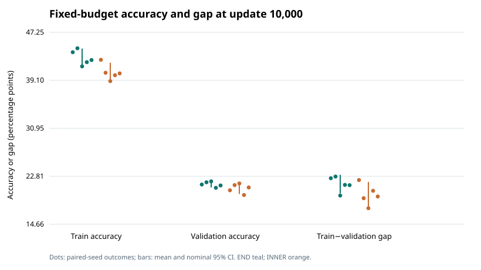

# Controlled position-of-untying follow-up

## Status and scope

This is a prospective, post-hoc exploratory mechanism follow-up. Original B/C/H official-test results were already known; this analysis uses validation only and does not access the official test. There is no independent confirmation. Historical H used separately initialized branches; END and INNER use cloned C-initialized branches and are distinct new arms, not a relabeling or retraining of historical H.

## Question and design

The question is whether freeing the boundary transformations helps more than freeing two interior transformations when capacity, branch-use counts, initial function, recipe, data and computation are held fixed. Both arms have 59,844 parameters, 37,973,120 forward MACs/example, eight residual applications, and branch use counts (1, 6, 1). `END` map: `[0, 1, 1, 1, 1, 1, 1, 2]` (unique positions 1 and 8); `INNER` map: `[1, 0, 1, 1, 1, 1, 2, 1]` (unique positions 2 and 7). The same-seed initial branch is cloned into independent branch parameter objects. This tests boundary versus interior placement, not whether capacity or looping universally wins. MAC counts do not establish latency.

## Primary endpoint

Primary outcome is selected-checkpoint validation top-1, in percentage points. The five paired seeds, not examples or checkpoints, are the units. END−INNER: **0.576 pp**, nominal two-sided Student-t 95% CI **[0.219, 0.933] pp** (df=4; unadjusted). The positive observed END−INNER point estimate favors boundary placement in this experiment. The nominal interval is entirely above zero and favors END under this recipe, but is not universal proof or a unique explanation for any historical seed outcome.

| Arm | Seed | Selected update | Validation top-1 | Validation cross-entropy | Native 15-bin ECE | Selected train-validation gap |
|:--|--:|--:|--:|--:|--:|--:|
| END | 11 | 9400 | 21.540% | 3.588731 | 14.556% | 22.371 pp |
| END | 23 | 7400 | 22.380% | 3.477979 | 12.417% | 17.576 pp |
| END | 37 | 9000 | 22.020% | 3.520600 | 12.579% | 18.913 pp |
| END | 53 | 8400 | 21.180% | 3.575319 | 13.607% | 20.398 pp |
| END | 71 | 10000 | 21.240% | 3.573717 | 13.276% | 21.293 pp |
| INNER | 11 | 9200 | 20.660% | 3.578759 | 13.435% | 21.629 pp |
| INNER | 23 | 7800 | 21.840% | 3.441705 | 10.792% | 16.871 pp |
| INNER | 37 | 9600 | 21.680% | 3.483282 | 11.191% | 17.231 pp |
| INNER | 53 | 7200 | 20.320% | 3.550164 | 11.589% | 17.791 pp |
| INNER | 71 | 9000 | 20.980% | 3.583383 | 11.830% | 19.042 pp |

| Seed | END−INNER selected validation top-1 (pp) |
|--:|--:|
| 11 | 0.880 |
| 23 | 0.540 |
| 37 | 0.340 |
| 53 | 0.860 |
| 71 | 0.260 |

## Secondary outcomes and dynamics

Selected-checkpoint cross-entropy is a separate predictive loss, not a calibration measure. ECE is the mean of the five native per-seed 15-bin ECE values; bins are validated within each seed and are not pooled across seeds. Fixed-budget values at update 10,000 are retained separately from selected-checkpoint values. Training accuracy and train-validation gaps describe optimization/generalization behavior but a gap alone is not causal proof of overfitting.

| Arm | Seed | Fixed train accuracy | Fixed validation accuracy | Fixed train−validation gap |
|:--|--:|--:|--:|--:|
| END | 11 | 43.867% | 21.400% | 22.467 pp |
| END | 23 | 44.533% | 21.780% | 22.753 pp |
| END | 37 | 41.467% | 21.940% | 19.527 pp |
| END | 53 | 42.178% | 20.840% | 21.338 pp |
| END | 71 | 42.533% | 21.240% | 21.293 pp |
| INNER | 11 | 42.578% | 20.420% | 22.158 pp |
| INNER | 23 | 40.378% | 21.300% | 19.078 pp |
| INNER | 37 | 38.956% | 21.580% | 17.376 pp |
| INNER | 53 | 39.956% | 19.620% | 20.336 pp |
| INNER | 71 | 40.267% | 20.900% | 19.367 pp |
 Native scalar histories were verified and per-update paired trajectories are in trajectories.csv and position-trajectories.svg.

## Frozen historical C8 reference

This is a descriptive reference from the existing frozen C8 study, not a newly randomized or retrained control, held-out confirmation, or historical H8 result. It is shown only for seeds whose data/split/subset identities match this study.

| Seed | Selected update | Validation top-1 | Cross-entropy | ECE | Selected train-validation gap |
|--:|--:|--:|--:|--:|--:|
| 11 | 8800 | 20.780% | 3.616791 | 13.973% | 18.576 pp |
| 23 | 10000 | 20.900% | 3.521623 | 12.706% | 17.567 pp |
| 37 | 9200 | 21.760% | 3.511528 | 12.629% | 15.662 pp |
| 53 | 7400 | 21.360% | 3.497939 | 10.493% | 14.907 pp |
| 71 | 10000 | 21.460% | 3.494924 | 12.066% | 18.118 pp |

## Matched C/H validation cohorts and gradient diagnostics

These post-hoc diagnostics compare frozen historical C8 and H8 on the same 5,000 validation examples per seed; historical H8 initialization differs from the new END/INNER arms, and frozen C8 is noncontemporaneous. Cohorts are matched images (not historical confidence-bin marginals). Top-1 delta is (H-only correct − C-only correct)/5,000; each NLL contribution is divided by the full 5,000-case cohort, and the four contributions sum to the reported float64 H−C mean NLL delta. These data characterize these validation cases only; they do not explain the historical official-test accuracy/cross-entropy tradeoff or unobserved original test examples. Validation is not an independent test. The fixed split seed 1729 reuses the same validation cases across all seeds; repeated predictions on shared images are not independent observations, and no classwise p-values are inferred. Native-compatible validation scalar checks may differ numerically from float64 cohort diagnostics; that numerical difference is not a new scientific effect.

| Seed | Both correct | C only correct | H only correct | Both wrong | H−C top-1 | H−C mean NLL | Both-correct NLL contribution | C-only contribution | H-only contribution | Both-wrong contribution | Both-wrong C max confidence | Both-wrong H max confidence |
|--:|--:|--:|--:|--:|--:|--:|--:|--:|--:|--:|--:|--:|
| 11 | 618 | 421 | 462 | 3499 | 0.820 pp | -0.10105846 | 0.00781344 | 0.13663183 | -0.15340590 | -0.09209783 | 0.3059 | 0.2843 |
| 23 | 593 | 452 | 484 | 3471 | 0.640 pp | 0.04769924 | -0.00498530 | 0.14774408 | -0.16281172 | 0.06775218 | 0.2981 | 0.3120 |
| 37 | 628 | 460 | 480 | 3432 | 0.400 pp | -0.06040001 | -0.00214179 | 0.15283750 | -0.15767901 | -0.05341672 | 0.3006 | 0.3019 |
| 53 | 641 | 427 | 532 | 3400 | 2.100 pp | -0.01159735 | -0.01480821 | 0.13824411 | -0.18488354 | 0.04985029 | 0.2780 | 0.3174 |
| 71 | 595 | 478 | 404 | 3523 | -1.480 pp | 0.16019973 | 0.00119526 | 0.16636720 | -0.12421590 | 0.11685317 | 0.2942 | 0.3160 |

Gradient probes use one fixed batch of 128 clean TRAIN examples per seed at common initialization and selected checkpoints. No optimizer updates are performed.

| Seed | Initial C8 rho | Within-group negative pairs / 28 | Selected C8 rho | Within-group negative pairs / 28 | Selected H shared-six rho | Within-group negative pairs / 15 | Max absolute conservation error |
|--:|--:|--:|--:|--:|--:|--:|--:|--:|
| 11 | 0.9611 | 0/28 | 0.7962 | 0/28 | 0.8609 | 0/15 | 3.73e-08 |
| 23 | 0.9759 | 0/28 | 0.8081 | 0/28 | 0.8620 | 0/15 | 3.73e-08 |
| 37 | 0.9670 | 0/28 | 0.7977 | 0/28 | 0.8484 | 0/15 | 3.73e-08 |
| 53 | 0.9683 | 0/28 | 0.8117 | 0/28 | 0.8669 | 0/15 | 5.96e-08 |
| 71 | 0.9697 | 0/28 | 0.7991 | 0/28 | 0.8803 | 0/15 | 5.96e-08 |

Position numbers in the raw diagnostics are zero-based; the report's descriptive branch grouping is C8 branch 0 (all eight positions) and H8 branch 1 (the shared six positions, positions 2–7 in one-based notation). Rho depends on group size (eight versus six); only within-shared-group negative pairs contribute to tied-gradient cancellation. At a fixed common function point, occurrence gradients gₜ add within each tied group: ∇θ_G L = Σₜ∈G gₜ. Positive dot products reinforce; negative dot products partly cancel. ρ = ||Σgₜ|| / Σ||gₜ|| measures local coherence, not evidence that larger gradients or lower conflict universally help. C8, END, and INNER share the same initial function but have different parameter coupling and update geometry. Selected C8/H8 are different learned parameter points, so their gradient comparison is descriptive, not a controlled causal comparison; these are gradients, not actual SGD/momentum/weight-decay updates.

## Matched END/INNER cohorts and selected gradients

Matched correctness is only argmax wins; NLL penalizes the true-class probability, including confident errors; ECE summarizes confidence/accuracy reliability in bins. These are not interchangeable. Per-class counts (50 validation cases per class) are in `class-error-counts.csv` and the raw diagnostics; these are descriptive only, with no classwise p-values or causal claims. Contributions below are weighted by group count / 5,000; all four sum to END−INNER mean NLL.

| Seed | Both correct | INNER only correct | END only correct | Both wrong | END−INNER top-1 | END−INNER mean NLL | Both-correct NLL contribution | INNER-only contribution | END-only contribution | Both-wrong contribution | Both-wrong INNER max confidence | Both-wrong END max confidence |
|--:|--:|--:|--:|--:|--:|--:|--:|--:|--:|--:|--:|--:|
| 11 | 631 | 402 | 446 | 3521 | 0.880 pp | 0.00997191 | -0.00732645 | 0.11705328 | -0.14096502 | 0.04121010 | 0.3022 | 0.3208 |
| 23 | 651 | 441 | 468 | 3440 | 0.540 pp | 0.03627399 | -0.00718110 | 0.13275782 | -0.15022006 | 0.06091733 | 0.2866 | 0.3087 |
| 37 | 653 | 431 | 448 | 3468 | 0.340 pp | 0.03731851 | -0.00687893 | 0.13702950 | -0.13410887 | 0.04127682 | 0.2884 | 0.3026 |
| 53 | 634 | 382 | 425 | 3559 | 0.860 pp | 0.02515470 | -0.01202502 | 0.10824194 | -0.13485064 | 0.06378842 | 0.2808 | 0.3070 |
| 71 | 615 | 434 | 447 | 3504 | 0.260 pp | -0.00966622 | -0.00465512 | 0.13248730 | -0.14160026 | 0.00410186 | 0.2850 | 0.3012 |

Selected-gradient shared-six comparison (rho and negative dot-product pairs):

| Seed | Common END rho | Within-group negative pairs / 15 | Common INNER rho | Within-group negative pairs / 15 | Selected END rho | Within-group negative pairs / 15 | Selected INNER rho | Within-group negative pairs / 15 |
|--:|--:|--:|--:|--:|--:|--:|--:|--:|
| 11 | 0.9768 | 0/15 | 0.9634 | 0/15 | 0.8812 | 0/15 | 0.7302 | 1/15 |
| 23 | 0.9862 | 0/15 | 0.9772 | 0/15 | 0.8994 | 0/15 | 0.7667 | 0/15 |
| 37 | 0.9825 | 0/15 | 0.9674 | 0/15 | 0.8795 | 0/15 | 0.7704 | 0/15 |
| 53 | 0.9816 | 0/15 | 0.9700 | 0/15 | 0.8918 | 0/15 | 0.8080 | 0/15 |
| 71 | 0.9818 | 0/15 | 0.9716 | 0/15 | 0.8443 | 0/15 | 0.7616 | 0/15 |

The protocol split seed 1729 fixes the same validation cases across all seeds. Repeated predictions on shared validation images are not independent image observations; paired seeds, not images, are the inference units. Frozen H8 initialization differs from new END/INNER; frozen C8 is noncontemporaneous, and selected C/H points differ. Local coherence is not the actual SGD/momentum/weight-decay update and does not prove why historical seed 71 lost.

## Mechanism and interpretation limits

The repeated residual operation is h[t+1] = h[t] + α F_θ[t](h[t]). C ties all eight transformations; H ties the six middle transformations and unties the endpoints. Setting A = S = Z embeds every C8 parameter setting in H8, but does not prove that H8 has a strictly larger function family or guaranteed generalization. Tying reduces free parameters but does not reduce the eight-step forward computation. It does not automatically improve validation accuracy or calibration.

This prospective analysis compares END versus INNER, not the historical H8 result. Historical H8 used a different initialization; frozen C8 is descriptive and noncontemporaneous. Validation is reused for checkpoint selection and evaluation and is not an independent official-test estimate. Split seed 1729 fixes the same validation cases across all seeds; repeated predictions on shared validation images are not independent image observations. The END−INNER effect is conditional on this recipe and selection rule: a CI entirely above zero nominally favors END, entirely below zero nominally favors INNER, and crossing zero is unresolved, not equivalence. No official-test claim is made; no historical seed-71 outcome is causally explained.

With diagnostics, the reported C/H comparisons are post-hoc description of matched validation examples and fixed training-batch gradients only. Probe gradients are not validation/test gradients and do not establish actual optimizer-update directions. No claim that the observed diagnostic pattern causes prospective END/INNER outcomes follows from these data. No official-test access or historical control retraining is represented here.
