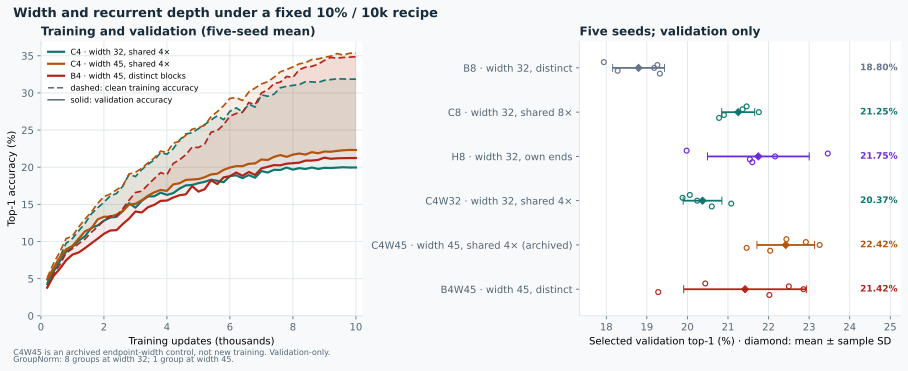

# Width, recurrent depth and sharing: validation-only controls

**Completed exploratory study.** Ten new runs: C4W32 and B4W45, five paired seeds each, 10,000 updates per run. C4W45 is reused from the archived endpoint-width study; B8, C8 and H8 are also archived controls. None of these controls was retrained.



The official CIFAR-100 test remained closed. All training, numerical analysis, tests and figure rendering ran on the Windows RTX 5090 PC, not on the Mac.

## Recipe and provenance

The [pre-training protocol](protocol.json) was committed in `b6fc4ac` before the scientific run. It remains unchanged, including its pre-training status and empty results field; outcomes are stored separately below.

- Seeds: 11, 23, 37, 53 and 71.
- Fixed stratified split: 45,000 training candidates and 5,000 validation images; split seed 1729. Each run uses a paired 10% subset of the training candidates: 4,500 images.
- SGD: batch 128, learning rate 0.03, momentum 0.9, weight decay 0.0005, cosine horizon 10,000, residual scale 0.1; FP32, AMP off.
- Validation every 200 updates; existing `amended_v2` checkpoint selection. No retuning or per-arm stopping.
- Native models: no custom branch maps or transplanted initialization for either new arm.
- Archived C4W45 was checked against its cohort, five raw logs and metadata: recipe, model specification, sample counts, data/split/subset hashes, selected/final metrics and canonical seeds. Each new run's paired input identity was also checked.
- Intervals are nominal paired Student-t 95% CIs, df=4. They are exploratory, not multiplicity-corrected, and do not establish equivalence when they include zero.

## Results

Selected validation accuracy is mean ± sample SD over five seeds. Training accuracy is measured on clean training examples. The final gap is clean training accuracy minus validation accuracy at update 10,000, not a difference between independently selected checkpoints.

| Model | Width | Unique blocks / steps | Parameters | Forward MACs / image | GroupNorm groups | Selected validation (%) | Final train (%) | Final gap (pp) |
|---|---:|---:|---:|---:|---:|---:|---:|---:|
| C4W32 — new | 32 | 1 / 4 | 22,724 | 19,098,752 | 8 | 20.37 ± 0.48 | 31.86 | 11.90 |
| C4W45 — archived | 45 | 1 / 4 | 42,445 | 37,640,340 | 1 | 22.42 ± 0.71 | 35.37 | 13.06 |
| B4W45 — new | 45 | 4 / 4 | 152,335 | 37,640,340 | 1 | 21.42 ± 1.51 | 34.87 | 13.64 |

MACs count convolution and linear operations, not normalization, activations or memory traffic. They are not measured latency.

### Prespecified contrasts

| Contrast, left minus right | Validation difference (pp) | Nominal paired 95% CI | Positive seeds |
|---|---:|---:|---:|
| C4W45 − C4W32 | +2.052 | [0.638, 3.466] | 5/5 |
| B4W45 − C4W45 | −1.004 | [−2.253, 0.245] | 0/5 |
| C4W32 − C8 | −0.880 | [−1.891, 0.131] | 1/5 |

Additional native-architecture contrast: **B4W45 − B8 = +2.624 pp [1.359, 3.889]**, positive in all five seeds. B4W45 averages 21.42%, versus B8's 18.80%. Their final gaps are 13.64 and 22.99 pp respectively. As with the shared models, this changes depth, width and normalization together.

### What the controls establish — and what they do not

1. **The wide C4 result is not explained by removing four recurrent steps alone.** At depth four, native width 45 beats width 32 by 2.05 pp in every seed. The narrower C4 does not show a validation improvement over C8; its −0.88 pp interval still includes zero. Widening also changes GroupNorm from eight groups to one, so this is a width/normalization package, not an isolated width effect.
2. **Sharing remains competitive at the same width, depth, GroupNorm setting and MAC count.** Archived C4W45 beats B4W45 in all five seeds, despite using fewer parameters. But the paired accuracy interval includes zero: this is a consistent observed ordering, not a conclusive superiority claim or an equivalence result.
3. **More parameters do not automatically mean more fitting at this fixed budget.** B4W45 has 152,335 parameters versus C4W45's 42,445, yet its mean final training accuracy is 34.87% versus 35.37%. Parameter count, sharing, optimization and depth cannot be collapsed into a single memorization explanation. These native-arm results do not establish behavior after longer or individually tuned training.
4. **The effect is not limited to recurrent models.** The shallow/wide native B arm improves validation over B8. Together with the shared-arm comparison, this supports investigating architecture shape rather than interpreting the old result as weight sharing alone.

## Historical endpoint dynamics: a separate posthoc analysis

The [endpoint dynamics report](results/endpoint-dynamics.md) reuses historical C8, H8, C7B1, C4B4 and B4C4 logs. It is not new training and is not a prespecified outcome of the width/depth run.

H8 has higher training accuracy and a larger gap than C7B1 in **all five seeds**, at both the selected and final checkpoints:

- Selected H8 − C7B1: training accuracy **+3.658 pp [0.776, 6.540]**; gap **+3.270 pp [0.778, 5.761]**.
- At update 10,000: gap **+4.392 pp [3.809, 4.975]** and validation CE **+0.112 [0.035, 0.189]**. Higher CE is worse.
- Selected validation top-1: H8 remains ahead by **+0.388 pp [−1.148, 1.924]**. The interval is inconclusive; C7B1 is not established as more accurate.
- C7B1 is **not selected earlier** on average: 9,200 updates versus H8's 8,440. Both first reach 19% validation accuracy at a mean 4,520 updates. First crossings are noisy sampled observations, not wall-clock or causal stopping-time evidence.
- B4C4 versus C4B4 shows the same overfitting pattern more strongly: final gap **+22.272 pp [19.447, 25.096]**, with no clear selected top-1 difference.

Thus the earlier summary was incomplete: lack of a clear top-1 gain does not erase the consistent training-fit, gap and CE differences. H8's independent first block and added capacity are associated with more overfitting here, but parameter count is not separated from first-block specialization. The new native controls further caution against treating parameter count alone as the causal mechanism.

The diagnostic preserves archived checkpoint CE as the selected metric. It separately reports tiny archive/log differences for C8/H8 (maximum below 1e−7); matched-update and final CE come from raw logs. No historical metric was rewritten.

## Execution and validation

The scientific run used a fresh, uniquely owned namespace, five training workers, two CPU threads each and a 0.15 GPU-memory fraction per worker. Train/meta were copied, not linked, with SHA verification. The scientific data root contained only `train` and `meta`; downloading was disabled. Outputs, checkpoints, caches and test temporary files stayed in the new namespace.

- Full scientific training: **754.814 s**, exit 0; ten completed runs, 10,000 updates each. Sampled GPU-memory peak: 5,568 MiB; sampled GPU-utilization peak: 81%, at five-second sampling.
- A separate non-scientific 400-update integration probe exercised all ten jobs before the full run. Its metrics are not included in the scientific analysis.
- Producer/regression checks: **18 passed, three workers**.
- Archive-analysis and compatibility checks: **14 passed, two workers, 14.712 s wall time**. These ran alongside training, within the shared CPU budget.
- Endpoint dynamics: **three tests passed**, followed by successful analysis of the actual historical logs.
- Actual scientific cohort plus archived-control analysis, raw-log/gzip round-trip hashes, finite values, source hashes and original/copied input hashes passed verification. Both original and owned input hashes were unchanged.
- The figure was rendered on the PC and its preview inspected. No Python process remained after postprocessing. No teardown deleted evidence.

Training wall times include concurrent contention, evaluation and checkpoints. They are **not** the isolated architecture latency measurements in the [separate speed benchmark](../rtx5090-speed-20261017/README.md).

## Artifacts and reproduction

- [Scientific cohort](results/cohort.json): exactly the ten newly trained C4W32/B4W45 runs.
- [Numerical analysis](results/analysis.json) and [readable tables](results/analysis.md): new arms plus explicitly identified archived controls.
- [Execution receipt](results/execution-receipt.json): source/input/artifact hashes, execution phases, resource boundary and export checks.
- `results/runs/<arm>-s<seed>/run.json` and `metrics.jsonl.gz`: public metadata and raw logs for the ten new runs. Checkpoints and dataset files are not committed.
- [Historical dynamics JSON](results/endpoint-dynamics.json) and [report](results/endpoint-dynamics.md).
- [Figure producer](../../scripts/make_width_depth_figure.py).

Use the existing environment on the RTX 5090 execution PC and fresh output directories. The data root must contain only the copied CIFAR-100 training pickle and metadata; no official-test file. Replace the uppercase placeholders with operator-chosen, uniquely owned paths:

```powershell
python -B benchmarks/split-sharing-20261017/run_split.py --data-root TRAIN_META_ONLY_ROOT --output NEW_RUN_ROOT --arms C4W32 B4W45 --device cuda --workers 5 --threads 2 --memory-fraction 0.15 --expected-data-hash 7b74250d9114dc502703e69138e516dd8a6b9b4cafd29b54bf2906e759650168
python -B benchmarks/split-sharing-20261017/analyze_split.py --cohort NEW_RUN_ROOT/cohort.json --output NEW_ANALYSIS_ROOT --archived-c4w45 benchmarks/endpoint-width-20261017/results/cohort.json
```

To reproduce the historical diagnostic, choose new output filenames:

```powershell
python -B benchmarks/width-depth-20261017/analyze_endpoint_dynamics.py --output NEW_DYNAMICS.json --report NEW_DYNAMICS.md
```

With the committed results present, render into new files in an existing directory:

```powershell
python -B scripts/make_width_depth_figure.py --output NEW_FIGURE.svg --preview-png NEW_PREVIEW.png
```
