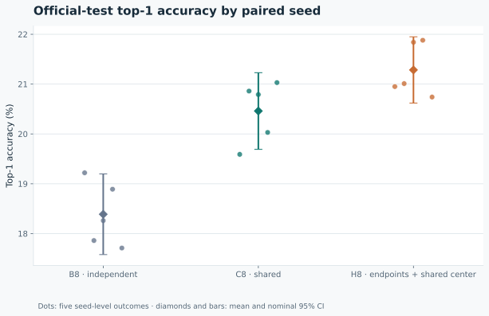
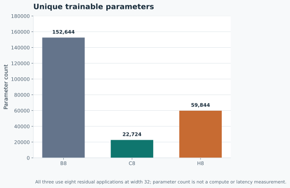
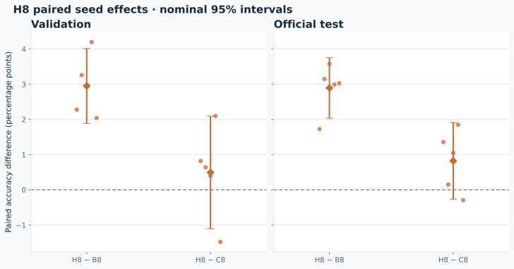

# H8 exploratory generalization follow-up

This report compares H8 with the frozen B8 and C8 controls on the existing CIFAR-100 study. It is an exploratory post-original-test follow-up: the official B/C/E test outcomes were already known before the H hypothesis and follow-up protocol. The original controls were not rerun. This is not an independent preregistered confirmation, and no fresh confirmatory success claim is made.

## Result

H8 official-test mean top-1 accuracy was 21.28% (nominal 95% Student-t interval 20.62 to 21.95%). The intervals below use five paired seed-level differences (df=4); both requested comparisons are exploratory and unadjusted for multiplicity.

| Contrast | Mean difference (percentage points) | Nominal 95% CI | Seed deltas (11, 23, 37, 53, 71) |
|:--|--:|:--|:--|
| H8 − B8, validation | 2.95 | 1.89 to 4.02 | 2.28, 3.26, 2.98, 4.20, 2.04 |
| H8 − C8, validation | 0.50 | -1.10 to 2.09 | 0.82, 0.64, 0.40, 2.10, -1.48 |
| H8 − B8, official test | 2.90 | 2.04 to 3.76 | 1.73, 3.15, 3.58, 2.99, 3.03 |
| H8 − C8, official test | 0.82 | -0.27 to 1.91 | 1.36, 0.15, 1.05, 1.85, -0.29 |

These values are generated only from supplied result evidence. Per-seed accuracy, cross-entropy, selected updates, checkpoint hashes, raw input SHA-256 hashes, and all model summaries are included in the [figure data](../assets/hybrid-figure-data.json) and [analytical outputs](../benchmarks/hybrid-generalization-20261015/analysis/).

## Where H8 gains and loses

| Model | Mean test top-1 | Mean test cross-entropy | Mean test ECE | Validation top-1 sample SD | Test top-1 sample SD |
|:--|--:|--:|--:|--:|--:|
| B8 | 18.39% (higher) | 3.631 (lower) | 8.84% (lower) | 0.640 | 0.652 |
| C8 | 20.46% (higher) | 3.546 (lower) | 12.88% (lower) | 0.406 | 0.620 |
| H8 | 21.28% (higher) | 3.562 (lower) | 13.32% (lower) | 1.254 | 0.535 |

Top-1 is higher-is-better; cross-entropy (CE) and expected calibration error (ECE) are lower-is-better. CE is not a calibration metric. ECE summarizes calibration using the producer's particular 15 equal-width confidence bins; it is not a bin-independent property. The dispersion columns are observed sample standard deviations across the five paired seeds, shown separately by split; they do not support a universal stability ranking.

Test-split H8−C8 deltas are shown below (CE in native units; negative favors H8).

| Seed | H8−C8 top-1 (pp) | H8−C8 CE | H8−C8 ECE (pp) |
|--:|--:|--:|--:|
| 11 | 1.36 | -0.114 | -3.03 |
| 23 | 0.15 | 0.072 | 1.81 |
| 37 | 1.05 | -0.031 | -0.62 |
| 53 | 1.85 | 0.009 | 2.13 |
| 71 | -0.29 | 0.144 | 1.90 |

H8 had higher top-1 in 4/5 seeds and lower CE in 2/5. H8 had lower ECE in 2/5.

Against B8, H8 had higher top-1 in 5/5 seeds and lower CE in 3/5. H8 had lower ECE in 0/5; B8 had lower ECE in 5/5.

C8 has lower observed mean CE and ECE than H8. Five-seed uncertainty remains substantial.

Seed 71 validation H8−C8 top-1 difference was -1.48 pp; its test difference was -0.29 pp. H8 was already behind C8 on validation and remained behind on test; this does not identify a cause. Seed 71 validation CE difference H8−C8 was 0.160; validation ECE difference was 3.17 pp.

H8's 59,844 parameters are 2.6335× C8's 22,724 (60.8% fewer than B8's 152,644); all have the same counted 37,973,120 MACs/example. This is a parameter trade-off, not a latency measurement. Extra H8 capacity also confounds attribution to endpoint specialization.

### Test confidence bands (descriptive)

| Model | Confidence band | Pooled count | Mean confidence | Accuracy | Confidence − accuracy |
|:--|:--|--:|--:|--:|--:|
| C8 | 0–<33.33% (bins 0–4 of 15) | 30,554 | 20.28% | 11.15% | 9.12 pp |
| C8 | 33.33–<66.67% (bins 5–9 of 15) | 15,068 | 46.15% | 28.50% | 17.65 pp |
| C8 | 66.67–100% (bins 10–14 of 15) | 4,378 | 80.37% | 57.74% | 22.62 pp |
| H8 | 0–<33.33% (bins 0–4 of 15) | 29,340 | 21.06% | 12.02% | 9.04 pp |
| H8 | 33.33–<66.67% (bins 5–9 of 15) | 16,050 | 46.16% | 27.79% | 18.37 pp |
| H8 | 66.67–100% (bins 10–14 of 15) | 4,610 | 80.48% | 57.59% | 22.89 pp |

Model-specific confidence groups pooled over five seeds; predictions reuse the same 10,000 images and are not matched cohorts or independent experimental units. These are model-specific confidence groups, not matched image cohorts: they cannot identify which classes or images H8 wins or loses on. The 50,000 pooled prediction instances per model reuse the same 10,000 images over five seeds; the experimental units remain five seeds, not images or predictions.

All diagnostics in this section are post-hoc, exploratory, and unadjusted. B8 has lower observed mean ECE than H8, so good calibration is not uniquely associated with pure looping. The measurements do not establish a class/task mechanism, causal explanation, regularization effect, or K-extrapolation superiority.

## Topology, protocol, and interpretation

The comparison moves from fully independent blocks in B8 and a fully shared block in C8 to endpoint-independent blocks with a shared center in H8. H8 has topology `[A,S,S,S,S,S,S,Z]`: the two endpoint blocks are independent while the six central applications share one block, for three unique blocks and eight residual applications at width 32. H8 has 59,844 parameters, compared with 152,644 for B8 and 22,724 for C8. H8 therefore has 2.6335 times C8's parameters; any observed difference cannot isolate endpoint specialization from added capacity. Under the existing MAC counting, all use 37,973,120 MACs per example; counting omits group normalization, ReLU, residual addition, pooling, and memory traffic. Parameter count does not establish compute or latency savings.

The H runs used five paired seeds, 4,500 training examples per run, 10,000 updates, batch size 128, SGD (momentum 0.9, weight decay 0.0005), learning rate 0.03, and cosine horizon 10,000. The checkpoint was selected on validation K8 by highest accuracy, then lowest cross-entropy, then earliest update. Only H was trained for this follow-up; B8/C8 measurements are reused from frozen original runs. This is not a fresh three-model replication. Five seeds are the experimental units, not individual images. The small training subset, five-seed uncertainty, two nominal comparisons, and post-hypothesis timing limit interpretation. No broad generalization claim is supported.







## Reproducibility and provenance

The underlying analytical outputs preserve SHA-256 hashes for H and historical control protocol, preregistration, freeze, validation, and test metrics. The original frozen control freeze hash is pinned and checked. Analysis validates the five H rows, both split/checkpoint identities, frozen H selection identities, and paired data/split/subset identities against both B and C controls.

The H-only operator is `benchmarks/hybrid-generalization-20261015/run_hybrid.py`; do not rerun the original B/C controls. Regenerate the analytical outputs and report from the supplied evidence into a fresh directory (run from the repository root in a POSIX shell):

```sh
RUN_DIR="$(mktemp -d)"
python benchmarks/hybrid-generalization-20261015/analyze_hybrid.py \
  --input-dir benchmarks/hybrid-generalization-20261015 \
  --controls-dir benchmarks/minimal-generalization-20261015 \
  --output-dir "$RUN_DIR/analysis"
python scripts/make_hybrid_figures.py \
  --analysis-dir "$RUN_DIR/analysis" \
  --output-dir "$RUN_DIR/assets" \
  --document "$RUN_DIR/docs/HYBRID_GENERALIZATION.md"
```

The analysis command requires an output directory that does not yet exist. These commands preserve the committed results and original publication artifacts.

