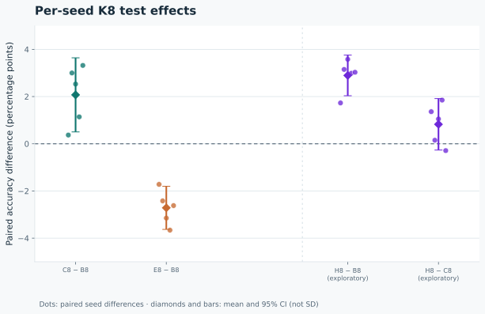
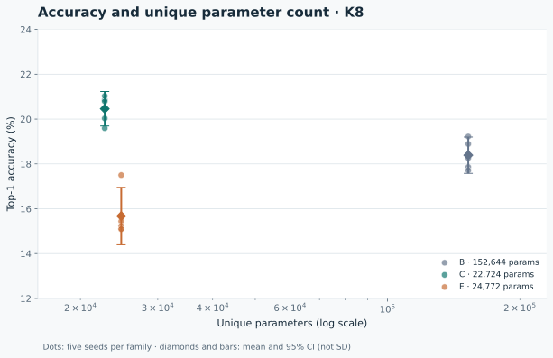
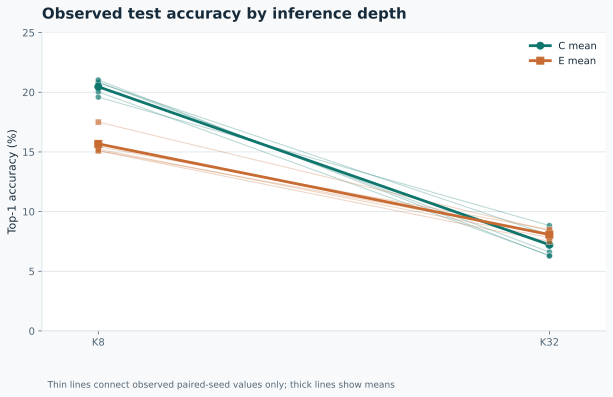

# Results: a small paired classifier study

This report summarizes a fixed, small-scale CIFAR-100 classifier experiment. It is a descriptive research result, not a broad benchmark or a claim of state-of-the-art performance, novelty, detection, or generalization beyond this setting.

## Main result

At inference K8, the tied recurrent model (C) scored 20.46% mean top-1 accuracy across five paired seeds, versus 18.39% for the untied baseline (B). The paired C8−B8 difference was **2.07 percentage points** (95% Student-t CI 0.50 to 3.64; n=5 paired seed-level differences, df=4). Each of the five seed-level differences was positive. The interval is above zero, meeting the protocol's favorable primary-result criterion.

The recurrent model with recall, variable depth, and progressive loss (E) scored 15.67% at K8. Its paired E8−B8 difference was **-2.71 points** (95% CI -3.63 to -1.80); this observed outcome is negative, not a gain. K32 was also lower than K8 for both recurrent models in every paired seed: C32−C8 -13.24 points on average and E32−E8 -7.60 points. These K32 comparisons are descriptive diagnostics, not confirmatory tests.

### K8 test results

| Model | Test top-1 at K8, mean (95% CI) | Per-seed test top-1 at K8 | Mean cross-entropy (native units) | Parameters | MACs / inference |
|:--|--:|:--|--:|--:|--:|
| Untied baseline (B) | 18.39% (17.58–19.20) | 19.22, 17.86, 18.26, 18.89, 17.71 | 3.631 | 152,644 | 37,973,120 |
| Tied recurrent model (C) | 20.46% (19.69–21.23) | 19.59, 20.86, 20.79, 20.03, 21.03 | 3.546 | 22,724 | 37,973,120 |
| Recurrent + recall, variable depth, progressive loss (E) | 15.67% (14.39–16.95) | 17.50, 15.44, 15.11, 15.23, 15.09 | 3.691 | 24,772 | 42,167,424 |

Paired C8−B8 test difference: **2.07 percentage points** (95% paired Student-t CI 0.50–3.64).

Per-seed values are ordered by seeds 11, 23, 37, 53, 71. Parameter counts are unique parameters; B and C have equal reported MACs per inference. Fewer parameters do not imply lower compute. MAC estimates omit normalization, activations, residual operations, pooling, and memory traffic.

## Protocol and limits

The experiment used five paired seeds (11, 23, 37, 53, 71), 4,500 training examples per run, 5,000 validation examples, 10,000 test examples, and 10,000 updates per run. The checkpoint was selected using validation K8 accuracy and cross-entropy tie-breaking, then evaluated on the test set. Each model family used the same paired seed identities and data/split identity. The analysis unit is a seed-level run, not an image; the reported mean confidence intervals use the two-sided Student-t distribution with df=4 and assume approximately normal paired differences. With only five seeds, this assumption and the resulting interval are uncertain.

C was selected as the primary comparison after exploratory calibration. This favorable result is therefore restricted: it is not independent of that prior exploration. Historical tuning was unequal across model families, and this is not a balanced search over all possible training recipes. Results should not be read as proof of superiority outside these exact settings. No claim is made about SOTA, novelty, detection, or broad generalization.

## Reproducibility and resources

Figures and tables are generated from the validated raw study records and the run metadata, rather than hand-entered metrics. The analysis reuses the study analyzer's roster, schema, pairing, provenance, finite-value, and sample-count checks. Parameter counts and MAC estimates are taken from the corresponding run records. B and C have the same reported MAC count per inference; their parameter counts differ. The parameter reduction is not a measured compute or latency saving. MAC accounting excludes normalization, activations, residual operations, pooling, and memory traffic.

Run `python scripts/make_figures.py --output-dir assets` from the repository root. The default evidence source is `benchmarks/minimal-generalization-20261015`; pass `--input-dir PATH` to validate a compatible frozen evidence directory. The figures are self-contained SVG files. Figure data and the generated table are in `assets/figure-data.json` and `assets/results-table.md`.
